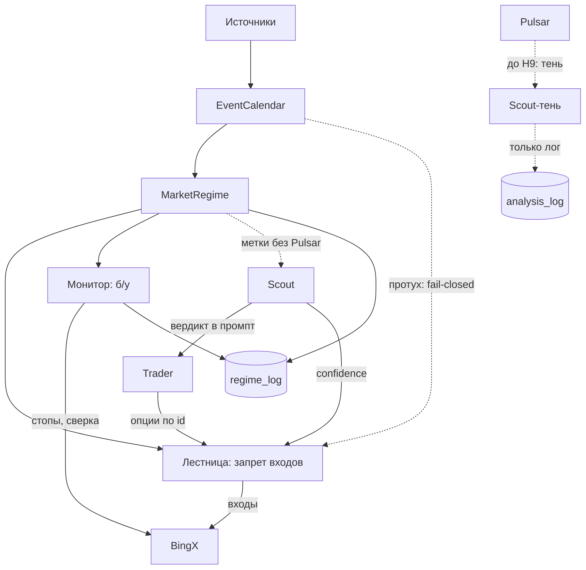
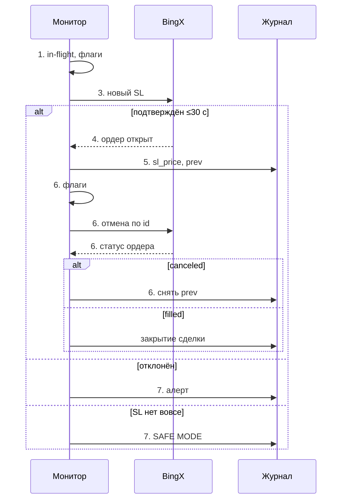
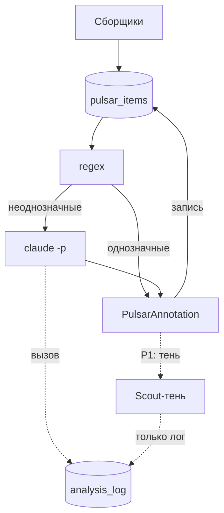

# Календарь событий в oskard без LLM, Pulsar — наблюдатель без вето (дизайн Sentinel)

> **Дальнейшие планы, не сейчас.** Сначала поток сверенных сделок R1–R5 ([[задачи — Сделано, Не проверено, План]]). Документ подробно раскрывает заметку [[календарь событий и Pulsar — режим рынка меняет управление позициями, а не риск на сделку]].
> Основа — пять исследований агентов от 2026-10-16 (код, каталог событий, источники данных, эмпирика, Pulsar). Документ исправлен по критике из 44 пунктов и затем по отчёту проверяющего (14 проблем). Что именно поменялось — в разделе «Изменения после критики», вторая проверка — в его части G. Время событий пересчитано через `zoneinfo`. Номера строк сверены с кодом 2026-10-16 поиском по имени функции и даны рядом с этим именем. Где данных нет, стоит «не проверено».

---

## 1. Суть идеи и место в плане

**Запрос Ивана (2026-10-16), своими словами.** OSKAR должен знать время важных событий:
- открытия бирж по часам;
- заседания ФРС;
- данные по инфляции и многое другое.

Знание событий нужно сочетать с анализом соцсетей (Pulsar) и учитывать при решениях. Около событий, особенно на открытии рынка, волатильность высокая. Ответить на это можно двумя способами:
- **агрессивно:** искать высокорисковые прибыльные сетапы;
- **защитно:** переводить стопы открытых позиций в безубыток и сверять с биржей, что ничего не потерялось.

**Как это понимаем мы.** Режим рынка влияет на две вещи: **как** открываем и ведём позиции и **разрешено ли** входить. Размер риска на сделку он не меняет, потолок 1% остаётся.

**Место в плане.** Фаза 3 исходного плана, Sentinel («третий агент: тренды, новости, соцсети»), делится на два блока.

| Блок | Природа | Где живёт | Права |
|---|---|---|---|
| **Sentinel-календарь** (EventCalendar + MarketRegime) | Детерминированный: время событий из официальных источников, без LLM | Внутри **oskard** | Включает жёсткие правила: запрет входов в окне, безубыток, сверку |
| **Pulsar** (соцсети и новости) | Python собирает и считает, LLM (`claude -p` по подписке) только ставит метку из перечня | Не решено (§8) | Только наблюдатель. **До проверки H9 на пути решения Pulsar нет ни у Scout, ни у Trader**: вердикт Scout целиком уходит Trader и в лестницу, поэтому Pulsar в Scout — это обходной путь к вето. С этапа P1 Pulsar видит только отдельный теневой вызов Scout, его ответ пишется в лог (§4.5). Вето нет |

**Почему календарь внутри oskard, а не крон Hermes.** Изначально его планировали кроном Hermes: [[архитектура — два процесса, oskard владеет биржей]], строка 22, и `config/settings.yaml:53`. Но Hermes лежал 13–16.10, а LLM у него нет с 11.10. Если запрет входов в окне живёт в Hermes, то при падении Hermes запрет **молча исчезнет**. По той же причине запрет не может идти через `MarketContext`, у которого «stale → neutral, никогда не блокирует» (§4.2, «Отказ источника»).

**Зависимость от R1–R5.** Блок меняет поведение исполнения, поэтому на него распространяется ст. 5 п. 3: подряд не больше двух невалидированных изменений. R1 ещё не провалидирован: INV-004 и INV-005 в `insufficient_data`, закрытых сделок 0. Значит, блок встаёт в очередь после R1–R5. Исключение — офлайн-исследование на истории (этап 1a в §7): торговлю оно не трогает.

---

## 2. Каталог событий

### 2.1. Летнее время

**«Инфляция в 15:30» верно только при летнем времени в США.** Все релизы в 08:30 ET выходят:
- в **15:30 МСК** со 2-го воскресенья марта по 1-е воскресенье ноября (EDT, UTC−4);
- в **16:30 МСК** в остальное время (EST, UTC−5).

Это касается CPI, PPI, NFP, заявок на пособие, PCE, GDP и Retail Sales.

- В 2026 году США переходят на зимнее время **01.11.2026**. Поэтому GDP+PCE 29.10 выйдут в 15:30 МСК, а NFP 06.11 и CPI 10.11 уже в **16:30**.
- Летнее время в США вернётся 14.03.2027.
- МСК всегда UTC+3, без перевода часов с 26.10.2014. Япония, Китай, Гонконг и Сингапур часы тоже не переводят.

| Зона | Правило | 2026 | 2027 |
|---|---|---|---|
| США (ET, CT) | +1 ч во 2-е вс марта, −1 ч в 1-е вс ноября, в 02:00 местного | 08.03 – 01.11 | 14.03 – 07.11 |
| ЕС и Великобритания | Последнее вс марта и последнее вс октября, в 01:00 UTC | 29.03 – 25.10 | 28.03 – 31.10 |

Даты переходов проверены через `zoneinfo` (tzdata 2026.3).

**Окна рассинхрона.** В эти недели Нью-Йорк отстаёт от Лондона на 4 ч, а не на 5:

| Год | Весна (США уже на летнем, Европа ещё на зимнем) | Осень (Европа уже на зимнем, США ещё на летнем) |
|---|---|---|
| 2026 | 08.03–29.03 | **25.10–01.11** |
| 2027 | 14.03–28.03 | **31.10–07.11** |

Пример: FOMC 28.10.2026 пройдёт в 21:00 МСК (США ещё на летнем), а ЕЦБ 29.10 — в 16:15 МСК (Европа уже на зимнем).

Sunshine Protection Act прошёл Палату представителей 14.07.2026, но в силу не вступил. Его стоит отслеживать.

**Следствия для кода:**
- Время вида «15:30» нигде не хардкодить. Хранить aware-datetime в UTC и исходную IANA-зону: America/New_York, America/Chicago, Europe/London, Europe/Berlin, Asia/Tokyo, Asia/Shanghai, Asia/Hong_Kong, Asia/Singapore, Europe/Moscow. Пересчитывать через `zoneinfo`. На Windows для этого нужен пакет `tzdata`. В `.venv` OSKAR он стоит (2026.3), но только транзитивно, через pandas: в `pyproject.toml` его нет. `exchange_calendars` (§3.1) не установлен вовсе. Оба пакета объявить в `pyproject.toml` явно, коммитом этапа 1 (§7). В системном Python `tzdata` нет.
- **Даты релизов не выводить из правил** вроде «1-я пятница» или «каждый четверг». Брать их только из источника (§3), а правило использовать для кросс-проверки. Пример: в неделю Рождества 2026 года 25.12 приходится на пятницу, и сдвиг заявок на пособие правилом не определить.
- Местное время в часы перевода неоднозначно или его не существует: осенью 01:00–02:00 ET 01.11.2026 бывает дважды (05:30 и 06:30 UTC для 01:30), весной 02:00–03:00 ET 08.03.2026 нет вовсе. `zoneinfo` в таком случае молча берёт `fold=0`. Парсер должен такие моменты распознавать и **падать явно** (§3.3).

**Killzones** ([[AMD и сессии — манипуляция происходит в Лондон и Нью-Йорк killzone]]). В библиотеке они заданы в МСК «UTC+3, летнее»: London KZ 10:00–12:30, NY KZ 15:00–17:30. Сдвиг на зиму у каждой своя дата: London KZ сдвигается по ЕС, NY KZ — по США. В коде killzones хранить **в местном времени**, а не в МСК.

| Killzone | Хранить так (местное) | Обе зоны на летнем | Окна рассинхрона (25.10–01.11.2026 и др.) | Обе зоны на зимнем |
|---|---|---|---|---|
| London KZ | 08:00–10:30 Europe/London | 10:00–12:30 МСК | 11:00–13:30 МСК | 11:00–13:30 МСК |
| NY KZ | 08:00–10:30 America/New_York | 15:00–17:30 МСК | 15:00–17:30 МСК | 16:00–18:30 МСК |

О сдвиге уже предупреждает `changelog.md:592`, запись про `smc/`: «времена в UTC+3 летнем — агентам учитывать DST».

### 2.2. Таблица событий

Колонка «МСК лето / зима» считается по летнему времени той зоны, к которой привязано событие: для ET и CT — по США, для London и CET — по Европе.

- **Важность и окна волатильности — оценки исследования, а не измерения.** Исключение — пиковый час после открытия NYSE и данные из §6. Стартовые окна калибруются в §6 (H1).
- **Жёсткий запрет входов включает не важность, а явный список `hard_block_kinds`** (§4.2). Пометка high в таблице сама по себе ничего не запрещает.
- **Периодичность** нужна только для кросс-проверки. Даты берутся из источника (§2.1).

**A. Сессии и структура рынка**

| Событие | Местное время / UTC | МСК лето / зима | Периодичность | Важность | Окно волатильности |
|---|---|---|---|---|---|
| Дневное закрытие крипты | 00:00 UTC | 03:00 / 03:00 | Ежедневно. Неделя закрывается в пн 03:00, месяц — 1-го числа | medium | ±15–30 мин (оценка). Совпадает с фандингом 00:00 UTC. Эмпирика: особого всплеска нет |
| Токио (TSE), закрытие в 15:30 с 05.11.2024 | 09:00–11:30, 12:30–15:30 JST | 03:00–05:30, 06:30–09:30 (всегда) | Будни | low | 03:00–04:00 |
| Шанхай (SSE) | 09:30–11:30, 13:00–15:00 CST | 04:30–06:30, 08:00–10:00 (всегда) | Будни | low–medium | 04:30–05:30 |
| Гонконг (HKEX) | 09:30–12:00, 13:00–16:00 HKT, аукцион до ~16:10 | 04:30–07:00, 08:00–11:10 (всегда) | Будни | low–medium | 04:30–05:30 |
| Лондон (LSE) / Франкфурт (Xetra) | LSE 08:00–16:30 UK; Xetra 09:00–17:30 CET | Открытие 10:00 / 11:00; закрытие 18:30 / 19:30 | Будни | medium | Первый час |
| **Нью-Йорк (NYSE, Nasdaq)** | 09:30–16:00 ET (13:30 / 14:30 UTC) | 16:30–23:00 / 17:30–00:00 | Будни, кроме праздников США | high **как режим, не запрет**: в `hard_block_kinds` не входит (§4.3) | 09:30–10:30 ET. **Пик волатильности BTC около 10:00 ET**: 17:00 МСК летом США и 18:00 МСК зимой, примерно через 30 мин после открытия |
| Крипто CME: **24/7 с 29.05.2026** | Ежедневное ТО 16:00–16:02 CT (не проверено: страница CME не загрузилась); субботнее ТО 02:00–04:00 CT; сеттлмент 14:59–15:00 CT | ТО 00:00 / 01:00; суббота 10:00–12:00 / 11:00–13:00; сеттлмент 23:00 / 00:00 | Постоянно | low–medium | Классический «CME-гэп» выходных **устарел**. Часть клиентов работает по 5-дневному графику: открытие вс 17:00 CT = пн 01:00 / 02:00 МСК |

**B. Деривативы**

| Событие | Время | МСК | Периодичность | Важность | Окно |
|---|---|---|---|---|---|
| **Фандинг BingX** | 00/08/16 UTC = 08/16/00 SGT. В справке BingX время дано по SGT (00/08/16 SGT = 16/00/08 UTC), набор часов тот же | **03:00, 11:00, 19:00** (всегда) | Каждые 8 ч. **Часть контрактов на 4 ч или 1 ч**, бывает без анонса. Брать по символу из `nextFundingTime` | low для BTC; medium–high для альтов с экстремальным фандингом | −10…+5 мин. Эмпирика: устойчивого ценового паттерна нет. Фандинг — это издержка и признак перекоса |
| Опционы Deribit | 08:00 UTC, цена расчёта = TWAP индекса за 07:30–08:00 UTC | 11:00, TWAP 10:30–11:00 (всегда) | Дневные; недельные (пт); месячные (последняя пт); квартальные (последняя пт мар/июн/сен/дек) | Недельные low, месячные medium, квартальные high **как режим**: пиннинг 24–48 ч, это не повод для запрета | Пиннинг 24–48 ч, затем высвобождение гаммы: пт 11:00–14:00 |
| Фьючерсы и месячные опционы CME на BTC/ETH | Последняя пт месяца, 16:00 London; BRR за 15:00–16:00 London. Если день нерабочий в США или UK — предыдущий общий рабочий день | 18:00 / 19:00; окно BRR 17:00–18:00 / 18:00–19:00 | Ежемесячно | medium–low | Окно BRR |
| Опционы на акции США, quad witching | 3-я пт, 16:00 ET | 23:00 / 00:00 | Ежемесячно; квартальные в мар/июн/сен/дек | low–medium | Через корреляцию с акциями |

**C. Макро США.** Если не сказано иное: 08:30 ET = 12:30 / 13:30 UTC = **15:30 / 16:30 МСК**.

| Событие | Время | МСК лето / зима | Периодичность (для сверки) | Важность | Окно |
|---|---|---|---|---|---|
| **CPI, Core CPI** (BLS) | 08:30 ET | 15:30 / 16:30 | Ежемесячно, ~10–15 число | **high** | −15…+60 мин, затем вторая волна на открытии NYSE |
| **NFP и безработица** (BLS) | 08:30 ET | 15:30 / 16:30 | Обычно 1-я пт | **high** | −15…+60 мин |
| **PCE, Core PCE** (BEA; с 2026 выходит вместе с GDP) | 08:30 ET | 15:30 / 16:30 | Ежемесячно | medium–high | +60 мин |
| GDP: advance / second / third | 08:30 ET | 15:30 / 16:30 | Ежеквартально | advance medium–high, остальные low | +30 мин |
| PPI | 08:30 ET | 15:30 / 16:30 | Ежемесячно | medium | +30 мин |
| Retail Sales (даты из стороннего календаря) | 08:30 ET | 15:30 / 16:30 | Середина месяца | medium | +30 мин |
| Заявки на пособие (DOL) | 08:30 ET | 15:30 / 16:30 | Каждый чт; при праздниках сдвиг (25.11.2026 — ср). Неделя Рождества — только по DOL | low–medium | +15 мин |
| ADP | 08:15 ET | 15:15 / 16:15 | Ежемесячно, ср | low–medium | +15 мин |
| ISM Manufacturing / Services | 10:00 ET | 17:00 / 18:00 | 1-й / 3-й рабочий день | medium | +30 мин |
| JOLTS; UMich | 10:00 ET | 17:00 / 18:00 | Ежемесячно | low–medium | +15–30 мин |
| **Решение FOMC** | 14:00 ET (18:00 / 19:00 UTC) | **21:00 / 22:00** | 8 раз в год; SEP и dot plot в мар/июн/сен/дек | **high** | За −60 мин ликвидность падает, эффект до +3 ч, вторая волна в азиатскую сессию |
| **Пресс-конференция председателя ФРС** | 14:30 ET | **21:30 / 22:30** | При заседании | **high** | Частые развороты во время Q&A. **Warsh (председатель с 22.05.2026) допускал, что пресс-конференции будут не после каждого заседания**: проверять перед каждым |
| Протоколы FOMC | 14:00 ET, через 3 недели после решения | 21:00 / 22:00 | 8 раз в год | medium | +30–60 мин |
| Речи председателя, Конгресс | Время разное; доклады в Конгрессе в фев и июл, обычно 10:00 ET | — | Нерегулярно | medium–high | Во время выступления |
| Jackson Hole | Конец августа, речь председателя в пт 10:00 ET | 17:00 (лето) | Раз в год | high | ±2 ч. Кандидат в `hard_block_kinds` только после 1a |
| Период тишины ФРС (blackout) | Со 2-й субботы перед заседанием до конца следующего за ним дня | — | — | Фильтр | Правило общеизвестное, **по первоисточнику не сверено** |

**D. Другие центробанки и макро**

| Событие | Местное время | МСК лето / зима (Европа) | Важность | Примечание |
|---|---|---|---|---|
| **ЕЦБ** | Решение 14:15 CET, пресс-конференция 14:45 | 15:15/15:45 / **16:15/16:45** | medium (через DXY и EURUSD) | Время по сторонним источникам |
| Банк Англии | Чт 12:00 UK | 14:00 / 15:00 | low–medium | Даты по стороннему источнику |
| Банк Японии | Точного времени решения нет, ~11:30–13:00 JST; пресс-конференция 15:30 JST | ~05:30–07:00; пресс-конференция 09:30 (всегда) | medium–high (риск керри-трейда в йене, как в августе 2024) | Это **окно, а не точка** (`precision=window`, §4.2). Время по сторонним источникам |
| HICP flash еврозоны | 11:00 CET | 12:00 / 13:00 | low–medium | Время по памяти исследователя, **не сверено** |
| CPI, PPI, PMI Китая | ~09:30 Пекин | ~04:30 | low–medium | **Не сверено** |
| CPI Японии | 08:30 JST | 02:30 (всегда) | low | **Не сверено** |
| CPI Великобритании | 07:00 UK | 09:00 / 10:00 | low | **Не сверено** |

**E. Крипто-специфичные события**

| Событие | Время | Периодичность | Важность | Что учитывать |
|---|---|---|---|---|
| Потоки спотовых ETF BTC/ETH (Farside, SoSoValue) | Итоги вечером по ET или утром следующего дня (≈ ночь–утро МСК, ориентировочно) | Торговые дни | medium, фон | Реакция в азиатскую и европейскую сессии |
| Разлоки токенов | По графику вестинга; часто 00:00 UTC (03:00 МСК), точно — по Tokenomist или контракту | Нерегулярно | high для альта при cliff ≥~1% циркулирующего предложения | **Только метка**: бесплатного источника точного времени нет (§3). Давление ~30 дней до и ~14 дней после (вторичный пересказ Keyrock) |
| **Листинги и делистинги** (Binance, Coinbase, Upbit, OKX, Bybit, BingX) | Время в анонсе (UTC) | Нерегулярно | **high** для токена | **Делистинг перпетуала BingX = принудительное закрытие позиций и снятие ордеров.** Прямой кейс для «сверять, чтобы ничего не потерялось». Правило — в §4.7 |
| Хардфорки и апгрейды | По слоту или эпохе. Ethereum Glamsterdam: цель Q4 2026, форк Sepolia 06.10.2026 | Редко | low–medium | Биржи приостанавливают депозиты и выводы |
| Халвинг BTC | Блок 1 050 000, ≈13–20.04.2028 | Раз в 4 года | low для интрадея | Структурный фактор |
| Выходные и праздники США | Праздники и сокращённые дни NYSE — из `exchange_calendars` (XNYS), вручную не перечислять (§4.3) | — | medium | Тонкая ликвидность, много ложных пробоев. Релиз в день, когда NYSE закрыта, свою силу сохраняет (§4.3) |

### 2.3. Ближайший календарь (МСК)

Время пересчитано через `zoneinfo`. Даты взяты из исследования каталога, которое опиралось на BLS, BEA, Fed, ISM и сторонние календари. В коде даты берутся только из источников (§3).

| Дата | Событие |
|---|---|
| 25.10 (вс) | Европа переходит на зимнее время. Биржи в воскресенье закрыты: Лондон и Франкфурт впервые откроются в 11:00 в пн 26.10. Начало окна рассинхрона до 01.11 |
| 28.10 (ср) | **FOMC 21:00, пресс-конференция 21:30** (США ещё на летнем) |
| 29.10 (чт) | GDP Q3 + PCE за сентябрь **15:30**; ЕЦБ 16:15 / 16:45; открытие NYSE 16:30. Окна перекрываются (§4.2) |
| 30.10 (пт) | Банк Японии ~05:30–07:00 (сверить); месячная экспирация Deribit 11:00; CME 19:00 |
| 01.11 (вс) | **США переходят на зимнее время**: релизы 08:30 ET = 16:30, FOMC 22:00. NYSE впервые откроется в 17:30 в пн 02.11 (торги до 00:00) |
| 02.11 / 04.11 | ISM Manufacturing / Services 18:00 |
| 05.11 | Банк Англии 15:00 |
| 06.11 | NFP 16:30 |
| 10.11 | **CPI 16:30** |
| 13.11 / 17.11 | PPI / Retail Sales 16:30 |
| 18.11 | Протоколы FOMC ~22:00 (расчётная дата) |
| 25.11 (ср) | GDP, PCE, заявки на пособие 16:30 |
| 26.11 (чт) | NYSE закрыта (День благодарения) |
| 27.11 | Экспирации Deribit 11:00 и CME 19:00; сокращённый день NYSE (до 13:00 ET = 21:00 МСК) |
| 01.12 / 03.12 | ISM Manufacturing / Services 18:00 |
| 04.12 | NFP 16:30 |
| 09.12 | **FOMC с SEP 22:00 / 22:30** |
| 10.12 | **CPI 16:30** |
| 15.12 / 16.12 | PPI / Retail Sales 16:30 |
| 17.12 | Банк Англии 15:00; ЕЦБ 16:15 |
| 23.12 | GDP + PCE 16:30 |
| 24.12 (чт) | Сокращённый день NYSE. Заявки на пособие: дату в неделю Рождества правилом не определить, брать у DOL (**не проверено**). CME по правилу переносит квартальную экспирацию на 24.12, 19:00 |
| 25.12 (пт) | NYSE закрыта. Последняя пт квартала приходится на Рождество: квартальная экспирация Deribit по правилу в 11:00, как поступит биржа — **не проверено** |
| 30.12 | Последнее событие в BLS ICS. Дальше BLS только из годового YAML (§3.3) |

**Праздники NYSE начала 2027** (по правилам NYSE; в коде брать из `exchange_calendars`, сверить с пресс-релизом NYSE на 2026–2028): 01.01 (пт), MLK 18.01 (пн), Presidents' Day 15.02 (пн), Good Friday 26.03 (пт).

---

## 3. Источники данных

**Принцип.** Каждое событие, где важно точное время, покрыто **бесплатным первоисточником**: релизы в 08:30 ET, FOMC, фандинг, экспирации, открытия бирж. Бесплатного официального источника, где были бы консенсус-прогноз и факт в реальном времени, **нет**. Для системы на 15-минутках факт в реальном времени не критичен: реакцию видно по цене BingX. Важно заранее знать **окно** события.

### 3.1. Рекомендуемый стек

| Слой | Основной (бесплатный, официальный) | Резервный | Заметки |
|---|---|---|---|
| Расписание США | **BLS ICS** (`bls.gov/schedule/news_release/bls.ics`, **до 2026-12-30**) + **BEA JSON** (`apps.bea.gov/API/signup/release_dates.json`, до 2027-12, время уже в UTC) + **Fed `calendar.json`** (FOMC, пресс-конференции, протоколы, речи; **окно до 2026-12**). FOMC следующего года — из HTML `fomccalendars.htm` | **Годовой YAML в репозитории** (ревью-коммит, сверен с BLS, BEA и Fed): резерв и вход правила fail-closed (§4.2). Эталоном для EV-1 он **не служит**: эталон собирается отдельно, из FRED `releases/dates` и HTML `fomccalendars.htm` (§5). FRED (бесплатный ключ, только дата) и faireconomy — ещё и для кросс-проверки | Опрос раз в сутки, дифф с алертом на перенос дат (shutdown 2025 сдвигал релизы). История изменений — в `event_revisions` (§4.2) |
| ЦБ мира | Статичный YAML на год с официальных страниц ECB и BoJ, ежемесячная сверка с HTML. RSS Fed (`press_monetary.xml`), ECB, BoJ подтверждают, что событие состоялось | Eurostat ICS (HICP) | У BoJ время решения задано окном |
| Сессии и праздники | `exchange_calendars` (Apache-2.0) офлайн: XNYS, XLON, XTKS, XHKG, XETR | Страница и пресс-релиз NYSE на 2026–2028; `pandas_market_calendars` (MIT) | Обновлять раз в год. Есть ли календарь CME Crypto — проверить через `get_calendar_names()` |
| Крипто-микроструктура | **BingX** `premiumIndex` (без подписи, проверено: `nextFundingTime` и интервал по символу) + **дифф `contracts`** (status, apiStateOpen/Close, launchTime, maintainTime, offTime) + **Deribit** `get_expirations` и `get_instruments` (1 запрос/с) с OI через `get_book_summary_by_currency`. Всё с **live-хоста**, не с VST (§4.8) | ccxt `fetchFundingRate`; для делистингов — опрос страниц поддержки BingX (§4.7) | API анонсов BingX **не найден**. Заполняется ли `offTime` в момент анонса — **не проверено** (§4.7) |
| Прогноз и важность (макро вне США) | **faireconomy** weekly JSON (`ff_calendar_thisweek.json`): есть `impact` и `forecast`, **поля `actual` нет**. Только текущая неделя (`nextweek` отдаёт 404). Не чаще раза в час, кэш, проверять, что пришёл JSON, а не HTML «Request Denied» | Платно: TradingEconomics (~$149–299/мес по сторонним оценкам), Finnhub (premium) | **ToS серая**: Fair Economy запрещает копирование и редистрибуцию без согласия, только внутреннее использование. **`impact` faireconomy жёсткими правилами не управляет**: важность официальных событий задаёт своя таблица (§4.2) |
| Факт (actual) | В реальном времени не нужен. Сюрприз считать задним числом: BLS API v1 (без ключа, 25 запросов/сутки) или BEA/FRED минус прогноз faireconomy | — | — |
| Крипто-события | CoinMarketCal Free как фон: 3000 запросов/мес, топ-100, 7 дней, задержка 24 ч, только заголовок и дата | CoinMarketCal Standard $99/мес | **Разлоки бесплатно не достать**: Tokenomist, CryptoRank и DefiLlama платные. Альтернатива — скан в Pulsar на подписке LLM |

### 3.2. Чего не брать и почему

- **Investing.com**: ToS запрещает «use, store, reproduce» без разрешения, плюс Cloudflare.
- **FMP**: входит ли календарь во free-план, не подтверждено; без него приходит ответ 402. Проверить одним запросом.
- **DefiLlama `/emissions`**: без ключа отвечает 402.
- **BEA ICS**: устарел, последнее событие 2025-09-29.

### 3.3. Технические риски источников

- **Fed `calendar.json` не документирован.** В начале файла BOM, встречаются пустые `{}`, время вида «2:00 p.m.» без зоны (это America/New_York), `days` бывают списком. Нужен парсер с проверкой схемы и откатом на HTML.
- **Неоднозначное время в день перевода часов.** Время из `calendar.json` в интервале 01:00–02:00 ET 01.11.2026 неоднозначно, а 02:00–03:00 ET 08.03.2026 не существует. Задавать `fold` явно. Если парсер встречает такое время без однозначной зоны, он **падает с ошибкой**, а не выбирает молча (CI-тест T-5).
- **BLS ICS заканчивается 2026-12-30, окно Fed `calendar.json` — 2026-12.** Примерно с 23.12 горизонт BLS станет короче 7 дней, и EV-12a покраснеет: CPI 13.01.2027 и январских NFP в ICS нет. Резерв — годовой YAML 2027 со страниц BLS и `fomccalendars.htm`, внесённый до 23.12.2026.
- **BLS отвечает 403** клиентам без контакта в User-Agent (проверено). Нужен свой UA с контактом. `TZID=US-Eastern` сопоставлять с America/New_York.
- **События с одной датой** (FRED, CoinMarketCal, часть ECB и BoJ) — `precision=date_only`: только метка, запрета не включают (§4.2).

---

## 4. Архитектура

### 4.1. Схемы

Вместо одной широкой схемы здесь три узкие, сверху вниз, с короткими подписями. Детали вынесены в таблицы под схемами.

**Схема 1. Обзор**

| Узел | Что делает | Где описано |
|---|---|---|
| Источники | BLS ICS, BEA JSON, Fed `calendar.json`, годовой YAML, BingX `premiumIndex` и `contracts` (live), Deribit, `exchange_calendars`. Загрузчики работают в отдельном потоке с таймаутами, сеть и разбор — вне замка журнала | §3, §4.2 |
| EventCalendar | Таблица `events` в SQLite, стабильные ключи, история переносов | §4.2 |
| MarketRegime | Чистая функция `(now_utc, events, символ)` → состояние и сессия | §4.3 |
| Scout → Trader, Scout → лестница | Вердикт Scout целиком вставляется в промпт Trader, `confidence` идёт в шаг `confidence_bounds`, ответ `pass` сразу даёт `scout_pass`. Поэтому всё, что видит Scout на пути решения, влияет на вето. В `MarketContext` Scout и Trader нет поля `pulsar` и событий `origin ∈ {pulsar, aggregator}` | §4.5 |
| Лестница: запрет входов | Шаг `event_window` в `evaluate` и повторная проверка в `_send_gate` исполнителя перед каждой отправкой. Данные идут **из календаря напрямую, не через `MarketContext`** | §4.2, §4.6 |
| Монитор: б/у | Перестановка стопа, снятие pending-входов, сверка после окна. Перестановка регистрируется в реестре in-flight, который ждёт panic. Флаги (panic, SAFE MODE, стоп по просадке) проверяются перед началом перестановки и перед отменой старого SL; восстановление защиты они не блокируют | §4.6 |
| BingX | Единственная правда (ст. 1): подтверждение каждой перестановки и сверка | §4.6, §4.7 |
| `regime_log` | Новая таблица: id события, режим, снепшот и `env` к каждому решению, каждому запрету входа и каждой перестановке (EV-6, EV-9). В `analysis_log` эти записи не ложатся: это лог вызовов LLM | §4.9, §5 |
| протух: fail-closed | Источник протух или события нет в таблице, но оно есть в YAML → входов в окне нет, плюс алерт | §4.2 |
| Pulsar → Scout-тень | До H9 Pulsar идёт только в отдельный теневой вызов Scout. Его ответ пишется в `analysis_log` и в решение не попадает (EV-29). К лестнице, монитору, Trader и боевому Scout стрелок нет | §4.5 |

**Схема 2. Перестановка стопа в б/у (§4.6)**

Номера в подписях — это номера шагов §4.6, а не порядковые номера сообщений. Шаг 2 (расчёт цены) и шаг 8 (сверка по выходу из окна) на схеме не показаны.

| Шаг §4.6 | Детали |
|---|---|
| 1 | Каждый шаг отправки регистрируется в реестре in-flight (panic его ждёт), затем проверяются panic, SAFE MODE и стоп по просадке. Если что-то взведено, перестановка не начинается. Ожидание подтверждения (шаг 4) идёт вне регистрации |
| 3 | Новый SL с cid `<cid>-sl-be1` и явным `workingType: MARK_PRICE` |
| 4 | Подтверждение через `protection_orders` / `order_status`: ордер открыт, триггер верный |
| 5 | Одной транзакцией: `sl_price` = новый стоп, `sl_order_id` = id нового, `sl_order_id_prev` = id старого, `sl_initial` не трогаем; строка в `sl_moves` и снепшот в `regime_log` |
| 6 | Повторная проверка флагов: если взведены, старый SL не снимаем, он остаётся в `sl_order_id_prev`. Иначе отмена **по exchange id** из `sl_order_id_prev`, не по cid. Очистка `sl_order_id_prev` — только при `order_status(...).status == canceled`. Если старый исполнился (`filled`) — путь закрытия сделки (EV-18) |
| 7 | Новый SL отклонён → старый остаётся, алерт. На бирже нет ни одного SL → SAFE MODE по образцу `_place_protection` |
| Запасной порядок | Если BingX не примет второй `closePosition`-стоп: флаги → отмена старого → `canceled` → новый SL. Новый SL здесь — восстановление защиты, флаги его **не блокируют** (§4.6, пункт про порядок) |

**Схема 3. Конвейер Pulsar (§4.5)**

| Узел | Детали |
|---|---|
| Сборщики | WS анонсов Binance (T1), страница Upbit раз в 60 с, RSS CoinDesk, The Block, Cointelegraph, Decrypt раз в 60–120 с (T2) |
| `pulsar_items` | `source`, `tier`, `source_ts`, `recv_ts`, `url`, `hash`; дедупликация. Сюда же пишутся поля аннотации: флаги P0 хранятся здесь, а не в `analysis_log` |
| regex | Привязка к монетам по списку перпетуалов BingX и алиасам; ключевые фразы |
| `claude -p` | Только неоднозначные T1/T2, порядка 50–200 заголовков в день. Telegram в LLM не идёт (ToS). Каждый вызов — строка `analysis_log` с `agent='sentinel'` |
| `PulsarAnnotation` | Перечни, **без чисел** |
| `analysis_log` | Только вызовы LLM: `claude -p` Pulsar и теневой Scout |
| Scout-тень | С P1, отдельный вызов Scout с Pulsar, только в лог, свой бюджет. **На пути решения Pulsar нет ни у Scout, ни у Trader до H9** |

**Рендер в артефакте.** `themeVariables.fontSize` 16px и `useMaxWidth: false`, как в директивах выше. На телефоне схема лежит в контейнере с горизонтальной прокруткой или открывается на весь экран по клику.

### 4.2. EventCalendar: детерминированный, таблица `events`

- **Модуль:** новый `src/oskar/context/calendar.py` внутри oskard.
- **Загрузчики** (сеть и парсинг) работают в **отдельном потоке** с таймаутами на запрос и разбор. В цикле монитора (`run_forever`, `core/position_monitor.py:845`) их нет. Монитор и лестница читают только таблицу `events`. Длительность тика монитора проверяет инвариант EV-16.
- **Запись загрузчиков не должна держать замок журнала.** Соединение с журналом общее на все потоки, а многошаговые записи идут через `transaction()` под общим для процесса `WRITE_LOCK` (`journal/db.py:159-177`). Тот же замок берёт `engage_panic`, когда пишет флаг в журнал (`core/emergency.py:107-110`), и только после этого снимает биржу. Поэтому:
  - сеть и разбор делаются **вне** замка, в памяти;
  - в `events` и `event_revisions` пишется короткими транзакциями, не дольше 100 мс под `WRITE_LOCK` каждая. Другой вариант — отдельная база календаря со своим соединением;
  - время удержания замка меряет EV-16b, задержку panic под нагрузкой загрузчика — CI-тест T-10.
- **Хранение:** таблица `events` в журнале SQLite (миграция) и таблица `event_revisions`.

| Поле | Значение |
|---|---|
| `event_id` | **Стабильный ключ** `источник:вид:период`, например `bls:cpi:2026-10` (CPI за октябрь) или `fed:fomc:2026-10`. Время в ключ не входит: при переносе id не меняется |
| `kind` | Перечень: `cpi`, `nfp`, `pce_gdp`, `fomc`, `ecb`, `boj`, `session_open`, `funding`, `expiry_deribit`, `expiry_cme`, `delisting`, `maintenance`, `drill`, … |
| `importance` | high / medium / low из **версионируемой таблицы kind → importance** в конфиге, а не из `impact` faireconomy |
| `ts_utc` | Aware ISO. Атрибут, а не часть ключа |
| `source_tz` + местное время | Для аудита пересчёта; `fold` для неоднозначных моментов |
| `precision` | exact / window / date_only |
| `scope` | market / symbol, плюс `symbols` |
| `source`, `source_url`, `fetched_at`, `content_hash` | Происхождение |
| `status` | scheduled / moved / cancelled / occurred |
| `origin` | official / exchange / aggregator / pulsar / drill |

- **Переносы и отмены:**
  - перенос (новое `ts_utc` при том же `event_id`) пишется в `event_revisions` и **пересчитывает окно**;
  - отмена снимает окно **только после подтверждения первоисточником**: в shutdown 2025 релизы и переносили, и отменяли;
  - любое изменение меньше чем за 24 ч до события — алерт оператору.
- **Кто включает жёсткие правила:** только события с `origin ∈ {official, exchange}` и только виды из `hard_block_kinds`. События Pulsar и агрегаторов в таблицу попадать могут, но правил не включают и в `MarketContext` Scout и Trader на пути решения не идут: при сборке контекста события с `origin ∈ {pulsar, aggregator}` отфильтровываются (§4.5). `drill` включает только учебную перестановку на VST с тем же триггером (§5, EV-2…EV-8).
- **Точность события:**
  - `exact`: окно запрета = [T − pre, T + post];
  - `window` (BoJ): окно = [начало − pre, конец + post]. T−10 для б/у отсчитывается от **начала** окна, у BoJ это ~11:30 JST = 05:30 МСК;
  - `date_only`: **никогда не включает запрет**, только метку.
- **Перекрытие окон:** окна объединяются, режим берётся по максимальной важности, T для б/у — самое раннее в объединённом блоке. Пример на 29.10.2026 (МСК): окно PCE+GDP 15:15–16:30; ЕЦБ 16:15 / 16:45 и открытие NYSE 16:30 — метки. Итог: один блок запрета 15:15–16:30, затем `post_event` с метками ЕЦБ и NYSE (CI-тест T-6).

**`hard_block_kinds` — явный список видов, которые включают запрет.** Стартовые значения калибруются по H1. EV-1 считается по макро-видам этого списка (`cpi`, `nfp`, `pce_gdp`, `fomc`); `delisting` и `maintenance` проверяют EV-21 и EV-22.

| kind | scope | Окно запрета входов | Б/у в T−10 | Время из |
|---|---|---|---|---|
| `cpi` | market | −15…+60 мин | да | BLS ICS + годовой YAML |
| `nfp` | market | −15…+60 мин | да | BLS ICS + годовой YAML |
| `pce_gdp` | market | −15…+60 мин | да | BEA JSON + годовой YAML |
| `fomc` (решение + пресс-конференция) | market | −30…+90 мин от 14:00 ET | да | Fed `calendar.json` + годовой YAML |
| `delisting` | symbol | С момента анонса и навсегда | — (§4.7) | BingX `contracts` / страницы поддержки |
| `maintenance` | market или symbol | За N мин до ТО и до его конца | — (проверка защиты, §4.7) | BingX `contracts.maintainTime` |

В каталоге для high было и более узкое окно, −15…+15–30 мин. Расхождение решает калибровка H1 (§6).

**Не входят** в список, только метки до данных 1a: открытие NYSE, квартальная экспирация Deribit, Jackson Hole, BoJ, ЕЦБ, протоколы FOMC, medium-события (ISM, PPI, Retail Sales), разлоки.

**Где лежит таблица окон и политика.** В новом версионируемом `config/events.yaml`, **не в `caps.yaml`**: тот закреплён хешем, и любая его правка меняет хеш в конституции.
- Расширить окно или добавить вид в список — это ужесточение. Оно свободно по ст. 4 п. 4, но меняет поведение, поэтому коммит идёт с инвариантом (ст. 5).
- **Сузить окно или убрать вид из списка — ослабление защиты по смыслу ст. 4.** Это делается только через proposal в `vault/proposals/` с данными 1a и инвариантом, простой правкой конфига нельзя.

**Отказ источника — fail-closed по известным событиям.** Это дефолт, вопрос 7 в §8 больше не открыт:
- (а) последний валидный снимок таблицы и годовой YAML **продолжают включать окна**, даже если загрузчик упал;
- (б) если high-событие из `hard_block_kinds` есть в YAML, но нет в таблице, или его источник протух больше чем на 26 ч, входов в окне этого события нет (время берётся из YAML), плюс алерт;
- (в) шаг `event_window` получает данные **из EventCalendar напрямую**: вызывающий код заполняет поле `RiskInput` из календаря. Через `MarketContext` данные не идут, потому что docstring `MarketContext` (`contracts/schemas.py:87-89`) — «stale → neutral, никогда не блокирует» — молча снял бы запрет. Это та же проблема, из-за которой календарь забрали из Hermes;
- источники вне `hard_block_kinds` (faireconomy, CoinMarketCal) работают fail-open: при отказе пропадают только метки.

### 4.3. MarketRegime

Чистая функция от `(now_utc, events, символ)`. Результат пишется в `regime_log` к каждому решению (§4.9, миграция).

| Состояние | Определение (старт, калибровать) | Что значит |
|---|---|---|
| `normal` | Нет событий high или medium в горизонте | Обычная работа |
| `pre_event` | Около 60 мин до начала окна события из `hard_block_kinds` | Признак для агентов; подготовка монитора. Запрещать ли входы уже здесь — вопрос 13 в §8 |
| `event_window` | Объединённое окно по `hard_block_kinds` (§4.2) | Нет новых входов, pending-входы сняты, защитные действия монитора |
| `post_event` | После окна до хвоста эффекта (у FOMC до +3 ч) | Сверка ордеров и позиций с биржей сразу по выходу из окна. Признак для агентов, не запрет |
| `shock` (опц., этап 2e) | Ценовой триггер в Python | Нет новых входов. См. «Известное ограничение» ниже |

**Сессия** (asia / london / new_york, флаги `weekend`, `us_holiday`, `dst_mismatch`) — **признак, а не запрет**. Открытие США бывает каждый будний день, и именно на NY KZ курс SMC рекомендует входить. Запрещаются только окна из `hard_block_kinds`.

**Праздники.** Праздники и сокращённые дни NYSE берутся из `exchange_calendars` (XNYS), руками не перечисляются (§2.3).
- **Релиз в день, когда NYSE закрыта** (так NFP вышел 02.04.2021, в Good Friday). Окно релиза действует, второй волны на открытии нет.
- **Флаг `us_holiday` окно релиза не отключает.**

**Известное ограничение: внеплановые события.** Экстренный FOMC (как в марте 2020), внеплановые речи и взломы календарь не ловит. Вариант без LLM: ценовой триггер в Python, всплеск реализованной волатильности или z-score ATR по свечам BingX → режим `shock` → нет входов. Пороги берутся из истории в 1a. Это отдельный опциональный этап 2e (§7) со своим инвариантом.

### 4.4. Политики режима как меню

Политику выбирает оператор в `config/events.yaml`. LLM её не выбирает (ст. 2).

**Смена политики — изменение поведения.** Переход `observe → defensive_v1`, как и любая другая смена, делается коммитом с инвариантом по ст. 5. **Это не переключатель через API или Telegram**, и в API и Telegram его нет. Переход к менее защитной политике считается ослаблением и идёт через proposal (§4.2).

| id | Статус | Действия |
|---|---|---|
| `observe` | Этап 1 | Только метки режима и сессии в `regime_log` и `MarketContext`. Поведение не меняется |
| `defensive_v1` | **По умолчанию** после валидации | (1) В окнах `hard_block_kinds` 0 новых входов: шаг лестницы `event_window`, повтор в `_send_gate`, pending-входы сняты (§4.6). (2) Перевод в б/у позиций, прошедших порог (§4.6), в момент T−10 мин, завершение не позже T−5. (3) Сверка ордеров и позиций с биржей по выходу из окна. (4) Отдельным изменением (этап 2d): повышенный `STOP_SLIPPAGE_PCT`, из-за которого уменьшается размер позиции, и выше пол ликвидности для альтов — **в `post_event` и в окнах medium-событий**. В окне запрета входов нет, поэтому применять это там не к чему |
| `defensive_medium` | Под вопросом (§8) | Для medium-событий: меньший размер, более жёсткие фильтры или только метка |
| `aggressive_shadow_v1` | Только shadow-когорта до валидации | «Новостные» сетапы внутри капа 1%, только BTC, ETH и топ по ликвидности. **Повышенное проскальзывание в сайзинге обязательно** (EV-14b). Своя статистика, с основной стратегией не смешивается (закон v1 «не смешивать непроверенное») |

**Варианты агрессивной логики** (из исследования эмпирики):
1. Стоп-ордера на пробой диапазона в обе стороны перед релизом — **не рекомендуется**: худшее исполнение в худший момент, пила выбивает обе стороны.
2. **Разворот после снятия ликвидности** — **рекомендуемый кандидат**. Порядок: ≥1 закрытая свеча M5/M15 после релиза → снятие хая или лоя диапазона до релиза или сессии → BOS по закрытию → вход на ретесте. Стоп за экстремумом снятия плюс буфер под событие. Вариант ложится на SMC (Judas swing) и не требует знать сюрприз за секунды.
3. Продолжение после первой закрытой 15-минутной свечи при большом сюрпризе. Нужен детерминированный фид консенсуса и факта: через LLM-цикл это слишком медленно, а бесплатного официального фида нет.

**Ограничения варианта 2:**
- **Вход после релиза попадает внутрь окна запрета.** Для shadow без ордеров это нормально. Для живой торговли нужно исключение из `event_window`. Это отдельное изменение риск-класса (ст. 5, авто-revert), а по смыслу ст. 4 — ослабление защиты, значит proposal.
- **Нужны новый детектор и новый тип сетапа**, это bump `schema_version`. Confluence-гейт (`risk/ladder.py:259-284`, шаг `confluence_gate` в `evaluate`: тренд по направлению + 2 сигнала из 3) такие сетапы срежет, а менять гейт — изменение риск-класса.
- **Данные M5.** Контракт допускает `"5m"` (`Timeframe`, `contracts/schemas.py:19`), кеш свечей знает TTL для 5m (`TTL_SEC`, `data/candles.py:16-23`). Но профиль intraday сканирует 15m и 1h (`config/profiles.yaml:10`), детектора на M5 нет. Грузятся ли M5 в рабочем контуре — **не проверено**. Начинать можно с M15.

### 4.5. Pulsar: наблюдатель без вето, до H9 только в тени

**Что говорят исследования.** Для 15-минуток нет оснований торговать по сентименту соцсетей: эффект мал или касается волатильности и объёма, а не направления. Пользу дают **дискретные официальные события**: листинги, делистинги, взломы.

**Pulsar не влияет на вето ни через Trader, ни через Scout.** У Trader есть вето (`TradeDecision` v2, `contracts/versions.py:11`). Скрыть от Trader поле `pulsar` мало: всё, что видит Scout, доходит до решения тремя путями.
- **Вердикт Scout целиком вставляется в промпт Trader**: плейсхолдер `{scout_verdict}` (`agents/prompts/trader.md:19`), подстановка в `build_prompt` (`agents/trader.py:43`). Это свободный текст `bull_case`, `bear_case`, `bear_rebuttal`, `tldr`.
- **Уверенность Scout идёт в лестницу**: `confidence=scout_verdict.confidence` (`core/escalation.py:112`) → шаг `confidence_bounds` (`risk/ladder.py:183-186`, `MIN_CONFIDENCE = 60` на `:86`).
- **Ответ Scout `pass` сразу даёт `scout_pass`**, без сделки (`__call__`, `core/escalation.py:80`, выход на `:91-92`).

Ещё одна утечка — `MarketContext.events`: Pulsar пишет туда события, а таблица `events` допускает `origin=pulsar` (§4.2). Контекст «без поля `pulsar`» их всё равно пропустил бы.

Поэтому до проверки H9:
- **Scout на пути решения работает без Pulsar.** Scout с Pulsar запускается **отдельным теневым вызовом**, только в лог, для когорт H9. Его ответ не идёт ни в `decisions`, ни в промпт Trader, ни в `RiskInput` (EV-29).
- **Теневой вызов пишется в `analysis_log` под своим агентом** (например, `scout_shadow`, миграция CHECK `agent`, `journal/db.py:97`). Бюджет `check_budget` считается по `agent` (`agents/budget.py:24-39`), так что под `agent='scout'` теневой вызов съедал бы бюджет боевого Scout. При нехватке бюджета первым пропускается теневой вызов.
- **Из `MarketContext` для Scout и Trader исключаются** поле `pulsar` и события с `origin ∈ {pulsar, aggregator}`. Теневой Scout получает контекст с ними.
- **EV-24 и EV-26 считают любой след Pulsar** в промптах Trader и боевого Scout: поле `pulsar`, событие с `origin ∈ {pulsar, aggregator}`, id из `pulsar_items`.
- В лестницу `pulsar` не попадает структурно: поле `pulsar` вносится в `FORBIDDEN_INPUT_FIELDS` (`risk/ladder.py:81`), а runtime-шаг `no_feedback_fields` (`evaluate`, `:168-170`) отклонит вход, если поле появится (CI-тест T-2).

«Без вето» значит: нет жёсткого правила, нет поля в лестнице, нет канала ни в Trader, ни в боевой Scout. Перевести Pulsar на путь решения (сначала в Scout) можно только после H9 на ≥ 60 сделках. Это отдельное решение Ивана: так Pulsar получает влияние на вето через Scout. Делается коммитом с инвариантом по ст. 5.

**Сборщики** (Python, детерминированно):
- WS-топик анонсов Binance `com_announcement_en` (T1);
- страница Upbit раз в 60 с;
- RSS CoinDesk, The Block, Cointelegraph, Decrypt раз в 60–120 с (T2, контекст, а не триггер).

Всё пишется в `pulsar_items`: `source`, `tier`, `source_ts`, `recv_ts` (для замера задержки), `url`, `hash`. Дедупликация идёт по url, hash и похожести заголовка.

**Делистинг на BingX — факт биржи.** Он идёт в Календарь, а не в Pulsar (§4.7).

**Привязка к монетам:** regex по списку перпетуалов BingX и таблица алиасов, без LLM.

**Классификация:**
- сначала regex: «will delist», «will list», «exploit», «drained», «withdrawals paused»;
- `claude -p` по подписке — только для неоднозначных T1/T2, пакетами раз в 5–15 мин или сразу на T1, порядка 50–200 заголовков в день;
- контракт `PulsarAnnotation`:
  - `category`: listing_spot / listing_perp / delisting / hack / unlock / regulatory / other;
  - `direction`: bull / bear / unclear;
  - `symbols`: только из переданных кандидатов;
  - `evidence_ids`;
  - `confidence`: low / med.

  **Чисел в контракте нет** (CI-тест T-3).
- для класса `hack` нужно подтверждение источником T1/T2: аккаунт X CertiK взламывали в январе 2024.

**Метрики (только Python):** число упоминаний монеты за 15 мин и z-score к базе за 7 дней.

**Выход:** аннотации в `pulsar_items`, события `origin=pulsar` в таблице `events`, поле `pulsar` в контексте **теневого** Scout. В `MarketContext` Scout и Trader на пути решения до H9 ничего из этого не попадает. Есть TTL; `stale` → neutral; **ничего не блокирует**.

**Этапы Pulsar:**

| Этап | Кто видит | Инварианты |
|---|---|---|
| **P0** | Никто. Флаги пишутся в `pulsar_items`, вызовы `claude -p` — в `analysis_log` (`agent='sentinel'`) | EV-9, EV-11, EV-24, EV-26 (последние два объявлены на этапе 3; если P0 идёт раньше этапа 3 — объявить здесь); CI T-2…T-4 |
| **P1** | Только теневой вызов Scout (аннотация, только лог). Telegram через Telethon (только счётчики и regex, без LLM — ToS Telegram) и Whale Alert как признак волатильности — тоже только в тень | EV-27 `telegram_items_sent_to_llm == 0`, EV-29 `shadow_verdict_in_decision == 0`; продолжают EV-24, EV-26; CI T-8 (каждое поле Pulsar в промпте теневого Scout есть в `STATS_MANIFEST.md`) |
| **P2** | Платный X (pay-per-use ≈ $0.005 за пост; 20 аккаунтов ≈ $45/мес) — только если P0/P1 покажут пользу | По итогам P1 |
| После H9 | Pulsar на пути решения — только отдельным решением Ивана и коммитом по ст. 5 (см. выше) | Новые инварианты на тот момент |

**Не брать:**
- Reddit: RSS отключается 13.11.2026, API закрывается к марту 2027;
- CryptoPanic: бесплатный план закрыт, Growth $199/мес;
- LunarCrush, Santiment (задержка 30 дней), Kaito, Arkham;
- X через cookie: нарушение ToS, риск бана.

### 4.6. Действия монитора: стоп в б/у как детерминированное правило со сверкой

**Хук.** `_check_open` (`core/position_monitor.py:504`): после `_ensure_protection` (вызов на `:527`) и до duration-stop (`_duration_stop`, вызов на `:533`).

**Порядок шагов** (ст. 1, схема 2):
1. **Предпроверки:**
   - **регистрация в реестре in-flight до проверки флагов.** Проверка флагов перед ордером — схема «проверил, потом действуешь», а `panic_flatten` идёт в другом потоке под `_FLATTEN_LOCK` (`core/emergency.py:54`, захват на `:121`). Без регистрации монитор может поставить SL `-sl-be1` уже после финальной зачистки защиты. Поэтому `replace_sl` до проверки флагов кладёт базу cid сделки и `(symbol, side)` в `_INFLIGHT` / `_INFLIGHT_TARGETS` (`core/executor.py:99-102`), как это делает `execute` для входа (`:357-367`). Регистрация берётся на каждый шаг отправки отдельно: «флаги + новый SL», «флаги + отмена старого», а в запасном порядке «флаги + отмена старого + статус `canceled` + новый SL» одним куском. Ожидание подтверждения ≤ 30 с (шаг 4) идёт вне регистрации, поэтому каждый шаг укладывается в ожидание panic. Panic ждёт этот реестр (`_await_inflight`, `emergency.py:86`) до 15 с (`PANIC_INFLIGHT_WAIT_SEC`, `:48`), затем финальным проходом снимает ордера с этой базой cid, включая `-sl-be1`, и закрывает позицию по `(symbol, side)` (`panic_flatten_inflight`, `position_monitor.py:805`). Другой вариант — брать `_FLATTEN_LOCK` на каждом шаге перестановки. CI-тест T-11;
   - panic, SAFE MODE или стоп по просадке → перестановка не начинается. Флаги проверяются **только перед началом перестановки и перед отменой старого SL** (шаг 6). Образец — `_send_gate` (`core/executor.py:295`), который вызывает `_halt_reason` (`:224`) перед каждой отправкой входа;
   - **восстановление защитного SL флагами не блокируется.** В запасном порядке «сначала старый, потом новый» (ниже) это второй шаг, и его блокировка оставила бы позицию голой. Под panic этот шаг идёт внутри регистрации in-flight, и финальный проход panic снимет новый SL вместе с позицией. В `_place_protection` (`position_monitor.py:402`) проверки флагов нет **намеренно**: SAFE MODE взводит он сам (`_set_safe_mode` на `:425`), когда защиту поставить не удалось. Туда проверку не добавлять;
   - режим `event_window` по виду из `hard_block_kinds`;
   - позиция прошла порог (открытый вопрос 3, §8);
   - запас между ценой б/у и текущей mark-ценой не меньше `be_min_gap_pct` из конфига. Значение должно учитывать тик-сайз и минимальную дистанцию стопа от mark на BingX (её величина **не проверена**). Если запаса нет, перестановка пропускается с меткой `no_room`: для лонга стоп выше цены сработал бы сразу или биржа бы его отклонила.
2. **Цена б/у** (считает только Python):
   - лонг: `вход × (1 + c)`;
   - шорт: `вход × (1 − c)`;
   - `c` = `ROUND_TRIP_FEE_PCT` (`risk/sizing.py:28`, сейчас 0,10%) + `STOP_SLIPPAGE_PCT` (`:39`, 0,05%) + `be_buffer_pct` из конфига.

   Вход — фактическая цена исполнения с биржи: `trades.entry_price` после promote (`_promote`, `position_monitor.py:338-347`). Из-за `STOP_MARKET` «ровный» б/у исполнился бы в минус.
3. **Новый SL** с cid `<cid>-sl-be1` и **явным** `workingType: MARK_PRICE`. У прикреплённых SL он задан (`place_entry`, `execution/bingx.py:110`), у отдельно поставленных нет (`_place_protective`, `bingx.py:144-149`). Какой триггер BingX берёт по умолчанию, не проверено.
4. **Подтверждение на бирже ≤ 30 с** через `protection_orders` / `order_status`: ордер открыт, триггер верный.
5. **Атомарное обновление журнала, одной транзакцией:**
   - `trades.sl_price` = новый стоп, `sl_order_id` = id нового SL, `sl_order_id_prev` = id старого (до подтверждённой отмены);
   - `sl_initial` не трогаем: там остаётся исходный стоп;
   - строка в `sl_moves` с `event_id`, `regime`, `drill`, `env`, снепшот режима в `regime_log`.

   **Зачем обновлять `sl_price`.** `_ensure_protection` (`position_monitor.py:371-400`) ищет и ставит защиту по `t["sl_price"]`. Если оставить там исходный стоп, то при пропаже стопа б/у монитор усыновит или восстановит исходный стоп, то есть ослабит защиту, и EV-17 покраснеет.
6. **Снятие старого SL по exchange id**, не по cid и не по цене:
   - перед отменой — повторная проверка флагов. Если они взведены, старый SL не снимаем: он остаётся в `sl_order_id_prev`, позиция защищена двумя стопами;
   - основной стоп ставится параметром входа (`place_entry`, `bingx.py:110`), и на бирже у него пустой cid. Это прямо сказано в docstring `owns_protection` (`execution/base.py:102-122`). Поэтому снимать по `sl_order_id_prev`;
   - **отмену нельзя проверять по «ордера нет».** `cancel_order` идемпотентен: «True = отменен или его уже нет» (`execution/base.py:205-206`). `_protection_state` превращает «ордер не найден» в `canceled` (`position_monitor.py:358-364`). Ни то, ни другое не отличает отмену от срабатывания. До очистки `sl_order_id_prev` нужен ответ `order_status(...)` со статусом `canceled`. Если ордер исполнился (`filled`), идём в путь закрытия сделки (EV-18). Если ордер не найден, смотрим историю (`protection_orders(..., include_closed=True)`, `base.py:209`). Если и там данных нет, `sl_order_id_prev` остаётся, уходит алерт, повтор на следующем тике;
   - старый стоп как б/у не «усыновят»: допуск поиска защиты 0,5% (`pick_protection`, `base.py:126`), а между старым стопом и ценой б/у не меньше ≈ 0,65% от входа (минимальная дистанция стопа 0,5%, `config/profiles.yaml:12`, плюс `c` ≥ 0,15%). Реальный риск обратный, он закрыт шагом 5.
7. **Если новый SL не встал**, старый остаётся и уходит алерт. В основном порядке голой позиции не бывает. Если на бирже нет ни одного SL — SAFE MODE по образцу `_place_protection` (вызов `_set_safe_mode` на `position_monitor.py:425`).
8. **По выходу из окна** — полная сверка ордеров и позиций с биржей (EV-19).

**Пока живы оба SL, срабатывание старого монитор не узнает.** Сейчас:
- `_close_if_protection_filled` (`position_monitor.py:454`) проверяет только `sl_order_id`;
- `_close_by_exchange_history` (`:468`) узнаёт свои ордера по id (`sl_order_id`, `tp_order_id`) или по `owns_protection` с `target_price=sl_price` и допуском 0,1% (`base.py:102-122`);
- сверка закрытых `Ownership.of` (`sync/reconcile.py:216-222`) берёт выходные ордера только из `sl_order_id` и `tp_order_id`;
- `_cancel_protection` (`position_monitor.py:438-444`) при закрытии сделки снимает только `sl_order_id` и `tp_order_id`. Старый прикреплённый SL с пустым cid переживёт закрытие, а `_scan_orphans` (`:661`, фильтр на `:693`) ордера без префикса `oskar-` пропускает. Забытый `closePosition`-стоп закроет **следующую** позицию по символу.

У старого прикреплённого SL пустой cid, а его триггер не совпадает с новым `sl_price`. Если он сработает в момент перестановки, сделка закроется как `manual`, а филл не сопоставится. Решение: учитывать `sl_order_id_prev` во всех четырёх местах, пока отмена не подтверждена (EV-18).

**Порядок «сначала новый, потом старый» может оказаться невозможным.** Отдельные SL ставятся с `closePosition: True` (`_place_protective`, `bingx.py:147`). Binance второй такой стоп в ту же сторону отклоняет (ошибка −4130). Если BingX ведёт себя так же, останется порядок «сначала старый, потом новый», а это голая позиция между двумя шагами: нарушение ст. 1 по смыслу, и EV-3 может покраснеть. В этом порядке флаги проверяются перед отменой старого SL, а постановка нового — восстановление защиты, которое не блокируют ни SAFE MODE, ни стоп по просадке, ни panic (шаг 1). Комментарий в `_ensure_protection` (`position_monitor.py:385`) исходит из того, что дубль `closePosition`-стопа безвреден, но принимает ли BingX два таких стопа, **не проверено**. Это первый пункт «Проверить до реализации». Запасные пути:
- qty-стоп без `closePosition` на полный объём позиции;
- cancelReplace / `edit_order`, если он есть у BingX.

**Длина cid.** `make_client_order_id` (`core/executor.py:153-157`) даёт `OSKAR-<run_id>-<12 hex>`, где `run_id` — 8 hex (`RuntimeState`, `core/state.py:13`). Итого 27 символов. `_place_protection` уже шлёт суффикс `-sl-rN`, это 33 символа при N < 10; с `-sl-be1` будет 34, с учебным `-sl-dN` (§5) — 33 при N < 10. Лимит длины `clientOrderId` у BingX **не проверен**. В истории кода уже была обрезка `[:36]` (docstring `make_client_order_id`), которая ломала сопоставление. Проверить до реализации.

**Монотонность стопа.** Стоп двигается только в сторону уменьшения риска: у лонга новый SL выше текущего, у шорта ниже. После окна он к исходному не возвращается. Инвариант EV-17 `sl_loosened == 0`.

**Открытые и ожидающие позиции:**

| Случай | Риск | Правило |
|---|---|---|
| **Лимитный вход**, выставленный до окна | Исполнится внутри окна → EV-1 краснеет → этап 2a откатывается автоматически. Лимитка живёт `limit_entry_ttl_seconds: 3600` (`config/profiles.yaml:14`) | Монитор снимает pending-входы не позже T − pre − 2 мин и проверяет отмену на бирже. Путь отмены с перепроверкой частичного филла уже есть в `_check_pending` (`position_monitor.py:286`), к нему добавляется причина `event_window`. Альтернатива — не ставить лимитки, срок жизни которых пересекает окно. Инвариант EV-1c |
| **Медленный LLM-цикл** | Решение, одобренное лестницей в T−16, уходит на биржу в T−12: карточка ждёт подтверждения до 20 мин (`approval_ttl_seconds: 1200`, `profiles.yaml:15`) | Повторная проверка `event_window` в `_send_gate` (`core/executor.py:295`) **перед каждой отправкой**, как сейчас проверяется `_halt_reason` |
| **Позиция не прошла порог к T−10** | Политики нет | Предложение по умолчанию: держать с исходным стопом, без ордеров в окне, отдельная когорта для H5. Алерт по фактическому убытку (§5, ст. 4). Варианты «уменьшать» и «закрывать» — вопрос 12 в §8 |
| **Вход в T−16 разрешён** | Порог такая позиция пройти не успеет | Вариант — запрет входов с начала `pre_event` для `hard_block_kinds`. Вопрос 13 в §8, решение по данным 1a |

**Порог перевода — открытый вопрос (§8).** Варианты из исследований:
- «прибыль больше издержек» (код);
- «≥ ~1R или частичная фиксация» (эмпирика: б/у в зоне шума почти гарантированно выбьет пила);
- книга: «б/у только после BOS» ([[Безубыток только после слома структуры по сделке, частичная фиксация 50 процентов у первой проблемной зоны]]).

Какой бы вариант ни выбрали, у событийного б/у своя причина закрытия: `breakeven` (§4.7, миграция).

**Ни одной стратегии нет в коде.** Логики б/у, трейлинга и частичной фиксации в `src` нет (grep пуст). У адаптера нет `amend`, `replace` или `modify_sl`.

### 4.7. Делистинг и техработы BingX

**Делистинг перпетуала:**
- **(а) Источник.** Заполняется ли `offTime` в `contracts` уже в момент анонса, **не проверено**. Если нет, дифф `contracts` узнает о делистинге слишком поздно. Тогда нужен опрос страниц поддержки BingX с `origin=exchange`, как предлагало исследование Pulsar. Парсер хрупкий, его здоровье идёт в `source_health`.
- **(б) С момента анонса:**
  - запрет входов по символу: шаг `event_window` со `scope=symbol`;
  - символ исключается из сканера. Сейчас в `scan` (`data/scanner.py:124`) списка исключений нет.
- **(в) Причина закрытия.** Сейчас принудительное закрытие биржей выглядит для монитора как исчезнувшая позиция без филла SL/TP. Такая сделка закрывается как `manual` (`_check_open`, вызов `_close(..., "manual")` на `position_monitor.py:523`), и делистинг смешивается с ручными закрытиями. Нужна новая причина `delisted`.
  - Миграция CHECK в `journal/db.py:62-63`: добавить `breakeven` и `delisted`.
  - **Тем же коммитом** — `KNOWN_CLOSE_REASONS` (`ops/invariants.py:47-49`). Иначе новая причина для INV-001 «неизвестна», и INV-001 покраснеет. А без правки CHECK запись просто упадёт.
- **(г) Позиция до `offTime`:** закрывать заранее или только алерт и сверка после принудительного закрытия — вопрос 8 в §8.
- Инварианты: EV-20 `delisted_symbol_open_positions_after_offtime == 0`, EV-21 `entries_on_delisting_symbol == 0`.

**Техработы (`maintainTime` в `contracts`).** Семантика поля **не проверена**.
- Запрет входов за N мин до начала ТО (N в `config/events.yaml`; предложение — 30 мин) и до его конца.
- До начала ТО — проверка через `protection_orders`, что у каждой открытой позиции на бирже стоит SL: во время ТО монитор защиту не поправит.
- Инвариант EV-22 `entries_before_maintenance == 0`.

### 4.8. VST против live

До гейта Фазы 5 приватный доступ к бирже идёт только через VST (`_sandbox` → `paper_gate`, `core/daemon.py:238`). Поэтому всё, что проверено на VST, требует оговорок.

| | Правило |
|---|---|
| (а) Данные о рынке | `premiumIndex`, `contracts` и Deribit всегда брать с **live-публичных эндпоинтов**, как уже делает `make_bingx_public_exchange` (`data/client.py:359`) для свечей. Список символов и делистинги на VST могут отличаться от live (**не проверено**) |
| (б) Проскальзывание | На VST оно нереалистично. H4 считается только по aggTrades (data.binance.vision), филлы VST доказательством не служат |
| (в) Метка среды | Колонка `env` в `trades`, `sl_moves`, `regime_log` и `analysis_log` (сейчас её нет нигде, `journal/db.py:41-105`) и в метриках инвариантов. Вердикты VST на live не переносятся |
| (г) Переход на live | EV-2…EV-5 повторно валидируются на малом размере |
| (д) Guaranteed Price | Доступность через API проверять и на VST, и на live |
| (е) Учебные события | `kind: drill` только при `env=vst`, новый SL с тем же триггером (§5, этап 2b) |

### 4.9. Точки интеграции в код

Ссылки сверены 2026-10-16 по текущему коду поиском по имени функции. Монитор и исполнитель лежат в `core/`, не в `execution/`.

| Слой | Где (`src/oskar/…`, строка — функция) | Что сделать |
|---|---|---|
| Календарь | новый `context/calendar.py`; `pyproject.toml` (`tzdata` только транзитивно, `exchange_calendars` нет) | EventCalendar, таблицы `events` и `event_revisions`, `zoneinfo`; `tzdata` и `exchange_calendars` объявить явно; загрузчики в отдельном потоке, запись короткими транзакциями под `WRITE_LOCK` (EV-16b, T-10) |
| Контракт | `contracts/schemas.py:87-100` — `MarketContext` (`events: list[str]` на `:98`); `contracts/versions.py:9` — `"MarketContext": 1` | Структурный тип события, режим, поле `pulsar` → `schema_version` 2 (ст. 2 п. 4) |
| Промпты | `core/daemon.py:180-184` — `scout_fn` в `_make_escalator` (`:159`) не передаёт `market_context`, поэтому Scout всегда видит `NEUTRAL_CONTEXT` (`agents/scout.py:17`, подстановка в `build_prompt` на `:41`); `agents/trader.py:39-47` — `build_prompt` (контекста нет вообще, но вердикт Scout вставляется целиком: `{scout_verdict}` в `agents/prompts/trader.md:19`, подстановка на `trader.py:43`); `agents/prompts/scout.md:19` — `{market_context}` | Передать контекст Scout. Scout и Trader на пути решения получают контекст **без поля `pulsar` и без событий `origin ∈ {pulsar, aggregator}`**; Scout с Pulsar — только отдельный теневой вызов (§4.5) |
| Мёртвое поле | `risk/ladder.py:77` — `RiskInput.context_stale`; нигде не выставляется: `core/escalation.py:110-118` и `core/cycle.py:48-50` (построение `RiskInput`) | Выставлять из `MarketContext.stale` (EV-25). Шаг `context_freshness` (`evaluate`, `ladder.py:179`) остаётся следом, а не блоком |
| Запрет входов | `risk/ladder.py:173-176` — шаги `safe_mode_off`, `not_paused` в `evaluate` (`:147`); вызывающие `escalation.py:110-118`, `cycle.py:48-50` | Новый шаг `event_window`. Поле `RiskInput` заполняется **из EventCalendar**, не из `MarketContext`. Это ужесточение, ст. 4 оно не задевает |
| Анти-вето | `risk/ladder.py:81` — `FORBIDDEN_INPUT_FIELDS`; шаг `no_feedback_fields` (`:168-170`). Канал Scout → решение: `confidence` в `RiskInput` (`core/escalation.py:112`) → `confidence_bounds` (`ladder.py:183-186`); `pass` → `scout_pass` (`escalation.py:91-92`) | Добавить `pulsar` (CI T-2). До H9 боевой Scout без Pulsar, теневой — `agent='scout_shadow'`, свой бюджет (EV-26, EV-29) |
| Повтор перед отправкой | `core/executor.py:295` — `_send_gate` (вызывает `_halt_reason`, `:224`, на `:301`); вызовы из `_place_entry` (`:500`) на `:503` и `:522` | Проверка `event_window` перед каждой отправкой входа |
| Pending-входы | `core/position_monitor.py:286` — `_check_pending` (отмена с перепроверкой филла) | Снятие pending в окне с причиной `event_window` |
| Б/у | `core/position_monitor.py:504` — `_check_open` (после `_ensure_protection` на `:527`, до `_duration_stop` на `:533`) | Хук из §4.6 |
| Panic в мониторе | Образец проверки — `core/executor.py:224` `_halt_reason`; реестр in-flight `_INFLIGHT` (`core/executor.py:99`), его ждёт `_await_inflight` (`core/emergency.py:86`). `core/position_monitor.py:402` — `_place_protection`: проверки флагов в нём нет **намеренно**, SAFE MODE взводит он сам (`:425`) | В `replace_sl`: регистрация в in-flight до проверки флагов; флаги — только перед началом перестановки и перед отменой старого SL (EV-5, T-11). **В `_place_protection` и в шаг восстановления защиты проверку флагов не добавлять** |
| Адаптер | `execution/base.py:174-213` — `place_sl` (`:174`), `order_status` (`:199`), `cancel_order` (`:205`), `protection_orders` (`:209`); `execution/bingx.py:127-158` — `_place_protective`, `:160` — `place_sl`; `execution/paper.py:134` — `place_sl`, `:153` — `cancel_order`. `cancel_order` идемпотентен: «True = отменен или его уже нет» (`base.py:205-206`) | Метод `replace_sl` в BingX и paper. Отмену старого SL подтверждать только статусом `canceled` из `order_status` (§4.6, шаг 6). Есть ли у BingX cancelReplace / `edit_order`, как он работает на VST и принимает ли биржа второй `closePosition`-стоп — **не проверено** |
| Журнал | `journal/db.py:54` — одна колонка `sl_price` в `trades`; `:62-63` — CHECK `close_reason`; `:94-105` — `analysis_log`. Это лог вызовов LLM: `agent` ограничен значениями scout / trader / analyst / sentinel (`:97`), `model`, `prompt`, `response` обязательны, колонки `env` нет. Записи режима и монитора туда не ложатся | Миграция: `sl_initial`, `sl_order_id_prev`; `sl_price` после перестановки хранит текущий стоп (§4.6, шаг 5); таблица `sl_moves` (`event_id`, `regime`, `drill`, `env`); новая таблица `regime_log` (режим, id события, снепшот, `env` к каждому решению, запрету входа и перестановке); причины `breakeven` и `delisted`; `env`. Для P1 — `scout_shadow` в CHECK `agent`. Сейчас выход по б/у запишется как `sl_hit` (`_close_if_protection_filled`, `position_monitor.py:458`; `_close_by_exchange_history`, `:501`) и смешается с настоящими стоп-аутами |
| Инварианты | `ops/invariants.py:275-306` — `entry_price_violations` (INV-004, читает `sl_price` на `:289`); `:47-49` — `KNOWN_CLOSE_REASONS`; `:53` — `MIN_TRADES_IN_HOURS_WINDOW`; `:55` — `_EXPECT_RE`; `:67-75` — `Window.parse`; `:82` — `Measurement.sufficient` | `sl_price` после перестановки — стоп б/у, и INV-004 по нему покраснел бы (дистанция ≈0% < 0,5%) → **авто-revert** (ст. 5 п. 4). Поэтому INV-004 читает `sl_initial`. Новые метрики EV-*. Окно `{be_moves: N}` и правила достаточности данных — отдельным коммитом в `ops/` (этап ops, §7) |
| Сверка закрытых | `sync/reconcile.py:216-222` — `Ownership.of`; `:225-236` — `Ownership.owns` (префикс `client_id + "-"` на `:234`) | Стоп с cid `<cid>-sl-…` уже распознаётся по префиксу. Добавить `sl_order_id_prev` в `exit_orders` |
| Закрытие сделки | `core/position_monitor.py:438-444` — `_cancel_protection` (только `sl_order_id` и `tp_order_id`); `:661` — `_scan_orphans` (ордера без префикса `oskar-` пропускает, `:693`) | Снимать и `sl_order_id_prev` (§4.6, четвёртое место) |
| Сканер | `data/scanner.py:124` — `scan` | Исключение символов в делистинге |
| Знания | `agents/scout.py:78-92` — `knowledge_for_candidate` (поиск только по типу сетапа, словарь на `:85-92`) | Заметка про сессии и killzones почти не попадает в промпт. Рассмотреть подачу сессии через `MarketContext` |
| Манифест | `agents/prompts/STATS_MANIFEST.md:19` (календарная информация разрешена для Scout и Sentinel); `:16` (`MarketContext` для Scout и Trader) | Внести признаки Pulsar, только для Scout (CI T-8) |
| Документация | `vault/atlas/архитектура — два процесса, oskard владеет биржей.md:22` («cron: Sentinel (60м)»); `config/settings.yaml:53` («Sentinel живет в Hermes») | Обновить тем же коммитом, что и этап 1 (ст. 7) |

---

## 5. Соответствие конституции

**Ст. 1 — биржа единственная правда.**
- Каждая перестановка стопа идёт так: новый ордер с cid `OSKAR-…-sl-be1` → подтверждение биржей → журнал (`sl_price` = новый стоп) → снятие старого **по exchange id** → проверка статусом `canceled` из `order_status`, а не по «ордера нет» (§4.6).
- Пока отмена не подтверждена, `sl_order_id_prev` участвует в распознавании закрытий и в сверке.
- После каждого окна из `hard_block_kinds` — сверка ордеров и позиций (EV-19).
- Делистинг перпетуала на BingX — событие календаря по символу: запрет входов с анонса, алерт и сверка после принудительного закрытия (§4.7).
- В `regime_log` пишутся id события, режим, снепшот и `env` к каждому решению, каждому запрету входа и каждой перестановке. `analysis_log` остаётся логом вызовов LLM.

**Ст. 2 — граница детерминизма.**
- Цену б/у, окна, размер и пороги считает только Python.
- Pulsar отдаёт только перечни, без чисел.
- Жёсткие правила включаются только календарём, а не строками, которые пишет LLM.
- Конституция допускает, чтобы LLM выбирала действие по id (hold / move_be / close), но в MVP этого нет: Pulsar — наблюдатель.
- Смена `MarketContext` и новые типы сетапов — bump `schema_version` ревью-коммитом.

**Ст. 3 — запрет самоусиления.**
- Внешнее расписание событий не является выходом системы, петли нет.
- **Pulsar без вето и без обходного пути к вето:**
  - до H9 ни Trader, ни боевой Scout не видят ни одного следа Pulsar (EV-24, EV-26). Обходной путь через Scout закрыт: его вердикт идёт в промпт Trader, `confidence` в лестницу, а `pass` сразу отменяет сделку (§4.5);
  - Scout с Pulsar — только теневой вызов в лог, его ответ в решение не попадает (EV-29);
  - лестница `pulsar` не принимает структурно (`FORBIDDEN_INPUT_FIELDS`, T-2);
  - если Pulsar станет жёсткой блокировкой, это противоречит docstring `MarketContext` («контекст, не альфа»).
- Pulsar не читает собственные каналы и алерты OSKAR (T-4).
- Каждая статистика Pulsar в промптах вносится в `STATS_MANIFEST.md` (T-8).
- Результаты когорт «в окне / вне окна» видит **только Analyst** (ст. 3 п. 4), в торговые промпты они не идут.
- Cap confidence 75 не меняется.

**Ст. 4 — капы и «ультра-рискованные сетапы».**
- Риск в долларах задаёт только `risk_per_trade_pct: 1.0` (`config/caps.yaml:17`). Плечо на риск не влияет: размер считается из риска и дистанции стопа, плечо меняет только маржу (`position_size`, `risk/sizing.py:159-162`).
- **«Ультра-рискованный» = агрессивный выбор внутри капа**: другой тип сетапа, другой момент входа, более широкий стоп. Шире стоп — меньше количество, а не больше риск.
- **Любой кап из `caps.yaml` поднимается только полной процедурой ст. 4 п. 2.** Это все шесть: `risk_per_trade_pct: 1.0`, `max_total_risk_pct: 5.0`, `max_leverage: 10`, `confidence_cap: 75`, `min_rr_fee_adjusted: 2.0`, `max_open_positions: 3` (`caps.yaml:17-22`). Процедура:
  - ≥ 60 закрытых сделок с PF ≥ 1,3;
  - proposal в `vault/proposals/`;
  - 48 ч охлаждения;
  - двухшаговое подтверждение;
  - обновление хеша тем же коммитом.

  Сейчас закрытых сделок 0.
- **Кап 1% номинальный.** 10.10.2025 стоп-маркеты по альтам исполнялись на падениях −40…−70% (§6.2). EV-14c проверяет плановый `risk_usd`, а не фактический убыток. Поэтому:
  - **алерт** `realized_loss_over_cap`: `realized_loss_pct_equity > risk_per_trade_pct × k` для сделок, переживших окно, с этапа 2a. Значение `k` фиксируется до прогона (вопрос 14, предложение — 1,5);
  - для `aggressive_shadow_v1` повышенное проскальзывание в сайзинге **обязательно** (EV-14b).
- Защитные правила (запрет входов, меньший размер) — ужесточение, по ст. 4 п. 4 оно свободно. Но это изменение поведения, поэтому подпадает под ст. 5.
- **Ослабление защиты по смыслу ст. 4** — сузить окна, убрать вид из `hard_block_kinds`, перейти к менее защитной политике, сделать исключение из `event_window` для живой агрессивной когорты — только через proposal с данными 1a и инвариантом (§4.2).
- Таблица окон и политика лежат в `config/events.yaml`, не в `caps.yaml` с его хешем.

**Ст. 5 — дисциплина валидации.**
- Каждый этап, меняющий поведение, — отдельный коммит с инвариантом в `config/invariants.yaml` **до** деплоя. Сюда входит и смена политики (§4.4).
- Подряд не больше двух невалидированных изменений. Очередь: R1 → … → R5 → этапы этого блока по одному-два.
- Б/у относится к классу «execution»: красный вердикт = авто-revert.
- Критерии успеха когорт фиксируются до прогона.
- **Формат окна** в `config/invariants.yaml` — только `{closed_trades: N}` или `{hours: N}` (`Window.parse`, `ops/invariants.py:67-75`), ожидание — только `<оператор> <число>` (`_EXPECT_RE`, `:55`). Поэтому:
  - проверки без окна вынесены в **CI-тесты**. Это не инварианты ст. 5;
  - окно `{be_moves: N}` требует расширить `Window.parse`. Это **отдельный коммит в `ops/`** (этап ops в §7), он идёт до объявления инвариантов этапа 1 и тем более 2b. Поведение торговли он не меняет. До него у каждой метрики с `{be_moves: N}` в таблице указан запасной вариант `{hours: 720}`;
  - **у каждой новой метрики своё правило достаточности данных** (`Measurement.sufficient`, `ops/invariants.py:82`), а не общее правило по закрытым сделкам. Сейчас окно `{hours: N}` без единой закрытой сделки даёт `insufficient_data` (`MIN_TRADES_IN_HOURS_WINDOW = 1`, `:53`). Для EV-12a, EV-12b, EV-16, EV-16b, EV-1b это означало бы `insufficient_data` в любые сутки без закрытой сделки, и этап 1 мог бы не провалидироваться никогда. Правила — в списке под таблицей инвариантов, реализуются тем же коммитом в `ops/`.
- **Валидация этапа 2b застрянет** без мер. High-событий 2–3 в месяц, и нужна ещё позиция, прошедшая порог. С окном 168 ч EV-2…EV-8 будут месяцами в `insufficient_data` и займут один из двух слотов для невалидированных изменений. Меры:
  - окно по числу перестановок `{be_moves: N}`;
  - **учебные события** `kind: drill`, только при `env=vst`. Они по расписанию (например, раз в 4 ч) прогоняют `replace_sl` на VST для открытых позиций. **Учебная перестановка ставит новый SL с тем же триггером**, что у текущего, с cid `<cid>-sl-dN`. Так проверяется механика (новый ордер, подтверждение, отмена старого по id, сверка), а риск и исход сделки не меняются. Иначе drill раз в 4 ч переносил бы в б/у стопы реальных позиций и портил бы основной поток R1–R5, базу PF для ст. 4 и выборку H5 (закон v1 «не смешивать непроверенное»). Порог для drill не нужен. Входов drill не запрещает, EV-1 его не считает. В `sl_moves` строка с `drill = 1`. Если сработка стопа пришлась на перестановку (например, на разрыв в запасном порядке), сделку видно по `drill = 1`, и её можно исключить из PF и когорт.

**Предлагаемые инварианты ст. 5** (machine-checkable; номера INV присвоить при объявлении):

| Этап | id | Правило | Метрика | Окно | Ожидание |
|---|---|---|---|---|---|
| 1 | EV-12a | Календарь видит вперёд | `calendar_horizon_days`: дни вперёд, покрытые событиями `hard_block_kinds` | `{hours: 24}` | `>= 7` |
| 1 | EV-12b | Календарь свеж | `calendar_last_ok_age_h`: возраст последней успешной загрузки | `{hours: 24}` | `<= 26` |
| 1 | EV-16 | Загрузчики не тормозят монитор | `monitor_tick_duration_max_s`. Порог стартовый: длительность тика сейчас не измеряется | `{hours: 24}` | `<= 30` |
| 1 | EV-16b | Календарь не держит замок журнала | `calendar_write_lock_max_ms`: самое долгое удержание `WRITE_LOCK` одной транзакцией календаря | `{hours: 24}` | `<= 100` |
| 2a | EV-1 | Нет входов в окне запрета (макро) | `entries_in_hard_block_window`: исполненные входы с `ts` в окне макро-видов `cpi`, `nfp`, `pce_gdp`, `fomc`. **Окна считаются по независимому эталону**: даты FRED `releases/dates` для релизов (время по правилу, 08:30 ET) и HTML `fomccalendars.htm` для FOMC (14:00 ET). Эталон собирает отдельный скрипт, не загрузчик календаря и не годовой YAML. Ограничение: событие, которого нет и в эталоне, EV-1 не увидит. `delisting` и `maintenance` сюда не входят, их проверяют EV-21 и EV-22 | `{hours: 168}` | `== 0` |
| 2a | EV-1b | Таблица и YAML не потеряли событие | `high_events_missing_vs_reference`: события макро-видов из эталона на 7 дней вперёд, которых нет в `events` или в годовом YAML | `{hours: 24}` | `== 0` |
| 2a | EV-1c | Pending-входы сняты к окну | `pending_entries_alive_in_window`: pending-входы, не снятые на бирже к началу окна | `{hours: 168}` | `== 0` |
| 2b | EV-2 | Перенос в б/у подтверждён биржей ≤ 30 с | `be_move_unconfirmed_30s` | `{be_moves: 10}` (до расширения формата — `{hours: 720}`) | `== 0` |
| 2b | EV-3 | Голых позиций нет | `naked_position_ticks`: тики монитора, где у открытой позиции на бирже нет SL | `{hours: 168}` | `== 0` |
| 2b | EV-4 | На сделку ровно один активный SL после перестановки | `orphan_sl_after_move`: старый SL на бирже **позже 120 с** после подтверждения нового (два полных тика монитора по 60 с). Не считаются перестановки, где отмену старого SL заблокировали флаги: он остаётся в `sl_order_id_prev` и учитывается EV-18 | `{be_moves: 10}` (до расширения формата — `{hours: 720}`) | `== 0` |
| 2b | EV-5 | Перестановка не начинается при panic, SAFE MODE или стопе по просадке | `be_move_started_while_halted`: считаются **только ордера, начинающие перестановку** (новый SL в основном порядке, отмена старого в запасном), отправленные при взведённых флагах. Восстановление защиты не считается | `{hours: 168}` | `== 0` |
| 2b | EV-6 | У каждой перестановки есть причина | `sl_moves_without_event_id`: строки `sl_moves` без `event_id` или без снепшота в `regime_log` | `{be_moves: 10}` (до расширения формата — `{hours: 720}`) | `== 0` |
| 2b | EV-7 | Выход по б/у не смешан со стоп-аутом | `sl_hit_with_moved_stop`: `close_reason='sl_hit'` при `sl_price != sl_initial` | `{closed_trades: 20}` | `== 0` |
| 2b | EV-8 | INV-004 не сломан перестановками | `entry_price_violations` (метрика INV-004, по `sl_initial`), только по сделкам с перестановкой | `{closed_trades: 10}` | `== 0` |
| 2b | EV-17 | Стоп не ослабляется | `sl_loosened`: перестановки, увеличившие риск, и возвраты к исходному стопу после окна | `{be_moves: 10}` (до расширения формата — `{hours: 720}`) | `== 0` |
| 2b | EV-18 | Срабатывание старого SL узнаётся | `prev_sl_fill_unrecognized`: по истории биржи сработал `sl_order_id_prev`, а сделка закрыта как `manual` или не сверена | `{closed_trades: 20}` | `== 0` |
| 2c | EV-19 | Сверка после каждого окна | `post_window_reconcile_missing`: окна `hard_block_kinds` без записи сверки не позже 5 мин после конца | `{hours: 168}` | `== 0` |
| 2c | EV-20 | Нет позиций по делистингу | `delisted_symbol_open_positions_after_offtime` | `{hours: 168}` | `== 0` |
| 2c | EV-21 | Нет входов после анонса делистинга | `entries_on_delisting_symbol` | `{hours: 168}` | `== 0` |
| 2c | EV-22 | Нет входов перед ТО | `entries_before_maintenance`: входы за N мин до `maintainTime` | `{hours: 168}` | `== 0` |
| 2d | EV-23 | Сайзинг учитывает событие | `entries_sized_without_event_slippage_in_window`: входы в `post_event` и окнах medium с базовым `STOP_SLIPPAGE_PCT` | `{hours: 168}` | `== 0` |
| 2e | EV-28 | Нет входов в `shock` | `entries_in_shock` | `{hours: 168}` | `== 0` |
| 3 | EV-24 | Trader не видит Pulsar | `trader_prompt_pulsar_trace`: промпты Trader в `analysis_log` с **любым следом Pulsar**: поле `pulsar`, событие с `origin ∈ {pulsar, aggregator}`, id из `pulsar_items` | `{hours: 168}` | `== 0` |
| 3 | EV-25 | `context_stale` правдив | `context_stale_mismatch`: `RiskInput.context_stale` ≠ `MarketContext.stale` того же решения | `{hours: 168}` | `== 0` |
| 3 | EV-26 | Боевой Scout не видит Pulsar | `scout_prompt_pulsar_trace`: то же для промптов Scout на пути решения (`agent='scout'`). Теневые вызовы (`agent='scout_shadow'`) не считаются | `{hours: 168}` | `== 0` |
| 4 (P0) | EV-9 | Жёсткие правила только от календаря | `hard_actions_from_llm_origin`: запреты входов (`regime_log`) и перестановки (`sl_moves`), у которых событие-триггер (`event_id` → `events.origin`) не из `{official, exchange}`. `drill` допускается только при `env=vst` | `{hours: 720}` | `== 0` |
| 4 (P0) | EV-11 | Ни одного числа от LLM в исполнении | `untraced_order_numbers`: цена или qty ордера, которые не прослеживаются до id кандидата детектора или до расчёта в Python | `{hours: 720}` | `== 0` |
| 4+ (P1) | EV-27 | Telegram не уходит в LLM (ToS) | `telegram_items_sent_to_llm`: вызовы `claude -p` Pulsar с `evidence_ids` из источника Telegram | `{hours: 168}` | `== 0` |
| 4+ (P1) | EV-29 | Теневой Scout не попадает в решение | `shadow_verdict_in_decision`: решения, у которых `verdict` и `confidence` в `decisions.scout_json` не совпадают с ответом боевого Scout (`agent='scout'`) того же `decision_id` в `analysis_log` | `{hours: 168}` | `== 0` |
| 5 | EV-14a | Агрессивная когорта не торгует вживую | `aggressive_cohort_live_orders` | `{hours: 720}` | `== 0` |
| 5 | EV-14b | Агрессивная когорта считает размер с повышенным проскальзыванием | `aggressive_sized_without_event_slippage` | `{hours: 720}` | `== 0` |
| 5 | EV-14c | Плановый риск в капе | `aggressive_risk_over_cap`: `risk_usd / equity > risk_per_trade_pct` | `{hours: 720}` | `== 0` |

EV-24, EV-25 и EV-26 объявляются на этапе 3 и действуют дальше, на всех этапах Pulsar, пока Pulsar не переведут на путь решения отдельным решением после H9 (§4.5).

**Достаточность данных по метрикам** (`Measurement.sufficient`; реализуется коммитом в `ops/` до этапа 1). Закрытые сделки нужны только тем метрикам, которые по ним и считаются:
- EV-12a, EV-12b, EV-1b — не меньше 20 почасовых снимков календаря за 24 ч;
- EV-16 — не меньше 1200 тиков монитора за 24 ч (при тике 60 с их 1440); EV-16b — хотя бы одна загрузка календаря в окне;
- EV-1, EV-1c, EV-19 — хотя бы одно окно макро-вида в периоде; EV-21, EV-22 — хотя бы один анонс делистинга или одно ТО; EV-20 — хотя бы один `offTime` в окне;
- EV-2, EV-4, EV-5, EV-6, EV-17 — N перестановок (до расширения формата — хотя бы одна за 720 ч); EV-3 — хотя бы один тик с открытой позицией;
- EV-7, EV-8, EV-18 — закрытые сделки, как сейчас;
- EV-23 — хотя бы один вход в `post_event` или в окне medium; EV-28 — хотя бы одно состояние `shock`;
- EV-24, EV-25, EV-26, EV-29 — хотя бы один соответствующий промпт или решение; EV-9, EV-11 — хотя бы один запрет, перестановка или ордер; EV-27 — хотя бы один вызов `claude -p` Pulsar; EV-14a…c — хотя бы один кандидат shadow-когорты.

Без события в периоде метрика остаётся в `insufficient_data`: отсутствие события — не доказательство. Вердикты существующих INV-* коммит в `ops/` не меняет (CI-тест).

**CI-тесты** (не инварианты ст. 5; бывшие EV-10, EV-11 в части схемы, EV-13, EV-15):

| id | Что проверяет |
|---|---|
| T-1 (был EV-13) | Летнее время считается, а не хардкодится. 08:30 ET 29.10.2026 → 12:30 UTC; 08:30 ET 10.11.2026 → 13:30 UTC; ЕЦБ 14:15 CET 29.10.2026 → 13:15 UTC. Осеннее окно 2027: 08:30 ET 03.11.2027 → 12:30 UTC (15:30 МСК), но 08:00 London 03.11.2027 → 08:00 UTC (11:00 МСК). Весна 2027: 08:30 ET 16.03.2027 → 12:30 UTC. Плюс grep литералов МСК-времени в `src/oskar/context/` |
| T-2 (был EV-10) | `pulsar` входит в `FORBIDDEN_INPUT_FIELDS` (`risk/ladder.py:81`); `test_no_feedback_fields` расширен |
| T-3 (был EV-11, схема) | В `PulsarAnnotation` нет числовых полей |
| T-4 (был EV-15) | В источниках Pulsar нет каналов и ботов OSKAR |
| T-5 | Парсер Fed падает на неоднозначном или несуществующем местном времени (01.11.2026 01:30 ET, 08.03.2026 02:30 ET) |
| T-6 | Перекрытие окон 29.10.2026 даёт один блок запрета 15:15–16:30 МСК |
| T-7 | Событие `date_only` запрета не включает |
| T-8 | Каждое поле Pulsar в промпте теневого Scout перечислено в `STATS_MANIFEST.md` |
| T-9 | Перенос события меняет `ts_utc`, но не `event_id`, и пишет строку в `event_revisions` |
| T-10 | Под нагрузкой загрузчика (полная перезагрузка BLS ICS, BEA JSON и Fed json) каждая транзакция календаря держит `WRITE_LOCK` ≤ 100 мс, а `engage_panic` записывает флаг и начинает flatten с задержкой не больше одной такой транзакции |
| T-11 | Panic, взведённый между проверкой флагов и отправкой нового SL, не оставляет на бирже ни позиции, ни SL `-sl-be1`. Восстановление SL в запасном порядке проходит при взведённом SAFE MODE |

**Ст. 6 — panic.**
- Флаги (panic, SAFE MODE, стоп по просадке) проверяются **перед началом перестановки и перед отменой старого SL** (EV-5), по образцу `_send_gate`. Восстановление защитного SL флаги не блокируют: иначе в запасном порядке позиция осталась бы голой (§4.6, шаг 1).
- **Гонка с panic закрыта реестром in-flight.** Перестановка регистрируется в `_INFLIGHT` (`core/executor.py:99`) до проверки флагов. Panic ждёт этот реестр (`_await_inflight`, `core/emergency.py:86`) и финальным проходом снимает всё, включая стоп б/у (T-11). Другой вариант — `_FLATTEN_LOCK` на каждом шаге.
- Загрузчики календаря работают в отдельном потоке с таймаутами и не держат тик монитора (EV-16). **Замок журнала они держат коротко**: сеть и разбор вне `WRITE_LOCK`, запись пачками ≤ 100 мс или в отдельную базу. `engage_panic` пишет флаг через `transaction()` под тем же замком (`emergency.py:107-110`) и только потом снимает биржу (EV-16b, T-10).

**Ст. 7 — vault.**
- Коммиты в `src/` идут вместе с `changelog.md`.
- **Этап 1 тем же коммитом обновляет** заметку [[архитектура — два процесса, oskard владеет биржей]] (строка 22, «cron: Sentinel (60м)») и `config/settings.yaml:53` («Sentinel живет в Hermes»): Sentinel-календарь больше не крон Hermes.
- Killzones и тайминги из книги остаются `book_claim`, пока данные их не подтвердят (§6, H6).
- Имена заметок — выводы.

---

## 6. Что говорят данные

**Качество доказательств:**
- **A** — рецензируемая статья или работа центробанка;
- **B** — отраслевое исследование с методологией;
- **C** — медиа, вендоры, единичные кейсы.

### 6.1. Макрособытия и сессии

- **FOMC.**
  - 41 заявление (2021–01.2026), часовые свечи. Средний |ход| BTC: 0,66% в час до заявления и 1,25% в час заявления. Превышение над плацебо (то же время неделей раньше) +0,44 п.п. [3, A, видели только аннотацию].
  - Направление: на сюрприз по текущей ставке BTC не реагирует, реакция на сюрприз по будущей траектории неустойчива (2017–2022) [1, A].
  - На дневных данных эффект незначим [20, C].
  - Спред 0,5→1,2 bp, глубина $2,43M→$1,92M [19, C].
- **CPI.**
  - Единственный макрорелиз, на который BTC реагировал в 2017–2022 [1, A].
  - 2020–2026, горизонт 1 ч: сюрприз объясняет 25% хода; +1 п.п. сюрприза даёт ≈ −5,5%; по последним 12 релизам R² ≈ 80%; через 4–24 ч эффекта нет [4, B, в статье есть нестыковка цифр].
  - Волатильность реагирует **до** релиза, у ETH сильнее, чем у BTC [2, A].
- **NFP.** В 2026 R² ≈ 0, пик был в 2024 (59%) [4, B]. Прямых исследований внутри дня мало.
- **Открытие США.**
  - Пик волатильности BTC в 14:00 UTC летом и в 15:00 UTC зимой, то есть около 10:00 ET: **17:00 МСК летом США и 18:00 МСК зимой**. На часы США приходится 55,7% волатильности при равномерной норме 37,5%, в праздники США — 41,9% [7, C, вторичный]. Каталог пересказывает то же как ~51% дисперсии за 13:00–22:00 UTC.
  - Kaiko: волатильность сосредоточена в часы США [8, B]. Более старые данные: объём и волатильность выше в часы бирж ЕС и США [6, A].
- **Азия.** Трендовые модели особенно прибыльны с вечера воскресенья (по Нью-Йорку) около суток; после 2020 эффект усилился [9, B].
- **00:00 UTC.** Минимум объёма около 00:31 UTC. Дневные экстремумы: основная мода в 18:00 UTC, вторичная около полуночи. Всплеска волатильности на закрытии дня нет [11, A, аннотация].
- **Фандинг.** Устойчивого ценового паттерна нет. Пик спредов примерно через 2 ч после расчёта показан на выборке всего в 2 месяца [21, C].
- **Экспирации Deribit.**
  - 1 059 экспираций (2021–2023): при высоком ATM OI цена проседает за час до расчёта и восстанавливается за 120 мин [12, B, пересказ].
  - Max pain не работает: 1 из 6 крупных серий [12].
- **Killzones.** Цифры вроде «снятие Азии 3–4 дня из 5» и «70% ложных пробоев в первый час» **не подтверждены** [22, C]. Механизм каскадов стопов у круглых уровней доказан только на валютном рынке [16, A]. Ловушка: у случайного блуждания экстремумы любого окна тяготеют к краям (закон арксинуса), поэтому нужна случайная база.
- **CME 24/7 с 29.05.2026:** новых «гэпов CME» и эффекта воскресного открытия больше нет [18].

### 6.2. Микроструктура и хвосты

- **Две фазы реакции** (облигации США) [15, A]: сначала мгновенный скачок со всплеском спреда, затем около часа повышенные объём и волатильность. Для крипты это согласуется с часовым горизонтом [3, 4].
- **Стакан до релиза** пустеет за 5–30 мин, но это утверждения практиков [17, C]. Прямых измерений по крипте нет.
- **10.10.2025:**
  - глубина верха стакана BTC упала более чем на 90%, интерфейсы бирж зависали [13, B];
  - глубина в пределах 10 bps: $48M → $26M [14, B];
  - альты внутри дня −40…−70%; у UNI максимум −70% при закрытии −27% [14, 23].

  **Стоп-маркет на альте может исполниться где угодно. Константа `STOP_SLIPPAGE_PCT = 0.05` (`risk/sizing.py:39`) такой хвост не покрывает.** Поэтому нужен алерт по фактическому убытку (§5, ст. 4).
- **Ложные движения.**
  - Кейс CPI: −$1 120 за минуту, затем разворот и +5% к 10:00 ET [24, C, одно событие]. Систематики по частоте разворотов нет.
  - Косвенно «за продолжение»: первые 30 мин сессии предсказывают последние 30 мин [10, A, без привязки к релизам].
- **BingX.**
  - Стоп по mark игнорирует фитили, но на быстром движении исполняется хуже триггера.
  - Есть платная опция «Guaranteed Price» [25]. Доступна ли она через API, на VST и на live — проверить.

### 6.3. Соцсети и новости (Pulsar)

Исследование Pulsar не градуировало степень доказательств. Горизонты в основном дни, а не 15 минут.

- **Сентимент:**
  - StockTwits значим только до 15 мин, эффект сосредоточен в период пузыря и слишком мал, чтобы на нём заработать (Guégan & Renault 2021);
  - число твитов предсказывает объём и реализованную волатильность **следующего дня** (Shen, Urquhart, Wang 2019);
  - внимание предсказывает **недельную** доходность (Liu & Tsyvinski).
- **Листинги:**
  - средняя аномальная доходность в день листинга 7,4%, у Binance 14,7%; рост за 2–3 дня до объявления (BRL 2019);
  - первый день: Coinbase 32,8%, Binance 22,7% (Li et al.).

  Для 15-минуток это признак «не шортить в памп», а не повод входить вдогонку.
- **Взломы:** к моменту объявления аномальная доходность возвращается к нулю (Corbet et al. 2020). Полезно как флаг риска для открытой позиции.
- **Маск:** эффект есть для DOGE, но не для BTC (Ante 2023).
- **Сигналы толпы, извлечённые LLM,** сильнее всего у малой капитализации и после падения (Haase et al. 2025).
- **Whale Alert** улучшает прогноз всплесков волатильности, но не направления (Herremans & Low 2022).
- **Шум:** боты дают 1–14% контента; памп-группы (412 пампов, Xu & Livshits 2019).

### 6.4. Гипотезы для проверки на когортах «в окне / вне окна»

**Выборка.** Одного paper недостаточно: это 2–3 события в месяц, а реальное проскальзывание VST не моделирует (§4.8). Основной инструмент — **исторический прогон на минутках 2021–2026**: ~30 макрособытий США в год, всего 150–200 событий.
- Цены: data.binance.vision, 1m klines и aggTrades USDⓈ-M, как прокси.
- Свечи BingX — для сверки последних месяцев: стакан у BingX тоньше.
- Даты событий: Fed, BLS, BEA.
- Выборки делить по режимам: до и после ETF (2024), до и после CME 24/7 (29.05.2026).
- **Критерии успеха — до прогона** (ст. 5). В исследованиях пороги не заданы.

| H | Гипотеза | Метрика | Данные |
|---|---|---|---|
| H1 | Окна −15…+60 (CPI, NFP, PCE) и −30…+90 (FOMC) покрывают повышенную волатильность | Поминутное отношение волатильности событие/плацебо от −120 до +240 мин → N для каждого вида | История 1m |
| H2 | В окне пила чаще, чем вне | Доля случаев, когда диапазон до релиза пробит в обе стороны за 60 мин, против случайного часа | История 1m |
| H3 | Разворот против продолжения после релиза | Частота разворота и продолжения после первой закрытой M5/M15 | История 1m |
| H4 | Проскальзывание `STOP_MARKET` в окне > 5 bps | VWAP за 1–5 с после триггера по aggTrades, в окне и вне | aggTrades (не VST) |
| H5 | Б/у до события улучшает net-R против удержания | Контрфактический анализ по журналу OSKAR: позиции, прошедшие порог к T−10, и не прошедшие | Журнал + резолвер R3 |
| H6 | Killzones: Азия снимается в Лондон чаще базы | Доля снятий диапазона Азии против случайного часа (с учётом арксинуса); KZ в местном времени | История 1m |
| H7 | Вариант 2 (свип → BOS → ретест после релиза) даёт положительное матожидание после издержек на BTC и ETH | Net-R когорты `aggressive_shadow_v1` против того же сетапа вне окон | Shadow + история |
| H8 | Вход в первый час NY для наших сетапов хуже или лучше | Когорта по сессии входа (признак, не запрет) | Журнал |
| H9 | Флаг Pulsar по символу за ≤ 60 мин до входа меняет исход | Когорты «с флагом / без», после ≥ 60 сделок; расхождения теневого и боевого вердикта Scout и исходы этих сделок | Журнал + `pulsar_items` + теневые вызовы Scout |

---

## 7. Поэтапный план

**Об оценках трудозатрат.** Это **оценка составителя**: в исследованиях трудозатраты не считались. Единица — рабочие дни агентной разработки, без времени на накопление данных.

**Об этапах.** Каждый этап, меняющий поведение, — отдельный коммит с инвариантом. Подряд не больше двух невалидированных (ст. 5 п. 3). Если 2a и 2b оба не провалидированы, 2c ждёт.

| Этап | Что | Меняет поведение? | Инварианты и тесты | Предпосылки | Оценка |
|---|---|---|---|---|---|
| **0** | R1–R5 завершены: поток сверенных сделок, INV-004 и INV-005 зелёные, ledger ст. 5 (R3) | — | — | — | — |
| **1a** | Офлайн-исследование на истории: H1–H4, H6 (data.binance.vision + даты Fed, BLS, BEA). Даёт стартовые окна, оценку проскальзывания и пороги `shock` | Нет | Критерии успеха — до прогона | Можно раньше этапа 0: торговлю не трогает | 2–3 дня |
| **ops** | **Отдельный коммит в `ops/`:** окно `{be_moves: N}` в `Window.parse`, правило достаточности данных для каждой новой метрики (`Measurement.sufficient`, §5). Вердикты существующих INV-* не меняются (CI-тест) | Нет: торговлю не трогает | CI на парсинг окон и неизменность INV-* | До объявления инвариантов этапа 1 | 0,5–1 день |
| **1** | **MVP календаря:** `context/calendar.py`, таблицы `events` и `event_revisions`, загрузчики в отдельном потоке (BLS ICS, BEA JSON, Fed json, годовой YAML, BingX `premiumIndex` и дифф `contracts` с live-хоста, Deribit), запись короткими транзакциями под `WRITE_LOCK`, MarketRegime, таблица `regime_log`, политика `observe`, алерты на переносы, скрипт эталона EV-1 (FRED + `fomccalendars.htm`). `tzdata` и `exchange_calendars` — явно в `pyproject.toml`. **Тем же коммитом** — заметка об архитектуре и `config/settings.yaml:53` (ст. 7) | Нет: только метки | EV-12a, EV-12b, EV-16, EV-16b; CI T-1, T-5, T-6, T-7, T-9, T-10 | Этапы 0 и ops | 3–4 дня |
| **2a** | **Защита: запрет входов.** Шаг `event_window` в лестнице (данные из календаря напрямую), повтор в `_send_gate`, снятие pending-входов, fail-closed по YAML, алерт `realized_loss_over_cap` | Да (risk) | EV-1, EV-1b, EV-1c | 1 | 1–1,5 дня |
| **2b** | **Защита: б/у со сверкой.** `replace_sl` в адаптерах; проверка на VST cancelReplace, `workingType`, второго `closePosition`-стопа и длины cid; миграция журнала (`sl_initial`, `sl_order_id_prev`, `sl_price` = текущий стоп, `sl_moves`, `breakeven`, `env`); INV-004 на исходный стоп; регистрация перестановки в in-flight, флаги перед началом и перед отменой старого SL, восстановление защиты без блокировки; отмена старого — только по статусу `canceled`; `sl_order_id_prev` в `_cancel_protection`; drill-события на VST с тем же триггером | Да (execution, авто-revert) | EV-2…EV-8, EV-17, EV-18; CI T-11 | 2a зелёный или в пределах лимита 2 | 3–5 дней + живая валидация |
| **2c** | Сверка после окна; делистинги BingX (`offTime` или опрос страниц поддержки, запрет входов, исключение из сканера, `delisted`); техработы `maintainTime` | Да (execution) | EV-19…EV-22 | 2b | 2–3 дня |
| **2d** | (Опц.) Повышенный `STOP_SLIPPAGE_PCT` и пол ликвидности альтов в `post_event` и окнах medium | Да (risk) | EV-23 | 1a (H4) | 0,5–1 день |
| **2e** | (Опц.) Режим `shock` по ценовому триггеру в Python | Да (risk) | EV-28 | 1a | 1–2 дня |
| **3** | **Когорты:** структурный `MarketContext` v2 → Scout (`scout_fn`, `daemon.py:180-184`) и Trader (`build_prompt`, `trader.py:39-47`) **без `pulsar` и без событий `origin ∈ {pulsar, aggregator}`**, `context_stale` из контекста; отчёт когорт «в окне / вне», сессии — только для Analyst | Да (промпты) | EV-24, EV-25, EV-26 | 2a–2c | 1–2 дня + накопление |
| **4** | **Pulsar P0 — наблюдатель:** сборщики, `pulsar_items`, regex, `claude -p` для неоднозначных T1/T2, `PulsarAnnotation`, `source_health`; только лог (`pulsar_items`, вызовы `claude -p` — в `analysis_log` с `agent='sentinel'`) | Нет: только лог | EV-9, EV-11, EV-24, EV-26 (если этап 3 ещё не пройден, EV-24 и EV-26 объявляются здесь); CI T-2, T-3, T-4 | 1 | 4–6 дней |
| **4+** | P1: теневой вызов Scout с аннотацией (`agent='scout_shadow'`, свой бюджет, только лог), Telegram-счётчики, Whale Alert → P2 (платный X) | Решения нет (тень); добавляет вызовы LLM | EV-27, EV-29; продолжают EV-24, EV-26; CI T-8 | 4 (P0); P2 — по итогам P1 | По итогам P0 |
| **5** | **Агрессивная shadow-когорта:** вариант 2, новый детектор и тип сетапа (bump `schema_version`), только BTC, ETH и топ, в капе 1%, повышенное проскальзывание обязательно. В живую — только после валидации по ст. 5 и proposal на исключение из `event_window`; поднять капы — только по ст. 4 | Shadow, без ордеров | EV-14a, EV-14b, EV-14c | 1a (H3), 3 | 4–6 дней + месяцы данных |

Pulsar на пути решения (сначала в боевом Scout) — не этап плана, а отдельное решение Ивана после H9 на ≥ 60 сделках, коммитом с инвариантом по ст. 5 (§4.5).

**Реализм по срокам данных.** High-событий в США около 30 в год, 2–3 в месяц. Набрать ≥ 60 сделок именно «в окне» на paper займёт много месяцев. Поэтому окна и агрессивную когорту доказывает прежде всего исторический прогон 1a, а paper служит сверкой. Для механики б/у (2b) счёт ведётся по перестановкам, включая drill на VST, а не по событиям.

---

## 8. Открытые вопросы к Ивану

1. **Инструменты.** Какие события важнее для твоей торговли? В Excel-журнале есть ETH, SOL и альты. Если альты в приоритете, делистинги, разлоки и пол ликвидности понадобятся раньше.
2. **Политика по умолчанию.** Согласен со схемой «защитная по умолчанию; агрессивная только shadow-когортой до валидации»?
3. **Порог перевода в б/у.** «Прибыль больше издержек», «≥ 1R» или «только после BOS», как в книге? Предложение: ≥ 1R до события и отдельная причина закрытия `breakeven`, чтобы сравнивать с книжным б/у.
4. **Окна.** Подходят ли до калибровки стартовые −15…+60 мин для CPI, NFP, PCE и −30…+90 мин для FOMC? Подходит ли стартовый `hard_block_kinds` (§4.2)?
5. **Medium-события** (ISM, PPI, ЕЦБ, Retail Sales). Уменьшать размер, ужесточать фильтр или только метить?
6. **Сессии.** Открытие NY — признак, а не запрет: по курсу SMC там как раз входят. Согласен?
7. **Отказ календаря.** Дефолт принят: **fail-closed по известным событиям** (§4.2). Последний снимок и годовой YAML продолжают включать окна, а при протухшем источнике или пропуске события входов в окне нет. Подтверди или возрази.
8. **Делистинг на BingX.** Закрывать позицию заранее, до `offTime`, или только алерт и сверка после принудительного закрытия?
9. **Где живёт Pulsar.** В oskard или в Hermes? У Hermes нет LLM с 11.10, и 13–16.10 он был недоступен.
10. **Источники:**
    - faireconomy (серая ToS, только внутреннее использование) — допустимо?
    - X pay-per-use (~$45/мес) — только после P0?
    - платные источники разлоков (CoinMarketCal Standard $99/мес, Tokenomist) или скан в Pulsar на подписке?
    - Telegram через Telethon (только счётчики, без LLM) — нужен?
11. **Guaranteed Price BingX.** Проверять ли доступность через API на VST и на live?
12. **Позиции, не прошедшие порог к T−10.** Держать с исходным стопом (предложение), уменьшать или закрывать?
13. **Запрет входов в `pre_event`.** Начинать запрет с начала `pre_event` (за ~60 мин до окна), чтобы позиция не входила за минуты до события без шанса пройти порог? Или только с T − pre? Решение по данным 1a.
14. **Алерт по фактическому убытку.** Какой `k` в `realized_loss_pct_equity > risk_per_trade_pct × k`? Предложение — 1,5.

### Проверить до реализации (не проверено в исследованиях)

**BingX:**
- **принимает ли биржа второй `STOP_MARKET` с `closePosition: True` в ту же сторону** (у Binance это ошибка −4130). От этого зависит порядок перестановки (§4.6);
- **лимит длины `clientOrderId`**: cid сейчас 27 символов, с `-sl-be1` будет 34. Принят ли биржей уже используемый `-sl-rN` (33) без обрезки;
- минимальная дистанция стопа от mark;
- `workingType` по умолчанию у отдельно поставленных SL;
- наличие cancelReplace / `edit_order` и поведение на VST;
- отдаёт ли `order_status` отменённый ордер по id и как долго: от этого зависит, подтверждается ли отмена старого SL статусом `canceled` или только по истории (§4.6, шаг 6);
- **заполняется ли `offTime` в `contracts` в момент анонса делистинга**, семантика `maintainTime`;
- совпадают ли список символов и делистинги на VST и live;
- API анонсов (не найден).

**Другие биржи и ЦБ:**
- нужна ли подпись ключом для WS-анонсов Binance;
- ежедневное ТО CME 16:00–16:02 CT;
- есть ли календарь CME Crypto в `exchange_calendars`;
- время решения BoJ и ЕЦБ (сторонние источники);
- квартальная экспирация Deribit 25.12.2026;
- заявки на пособие в неделю Рождества 2026 (DOL);
- расписание BLS и FOMC на 2027 для годового YAML (до 23.12.2026);
- правило blackout ФРС по первоисточнику;
- время HICP, CPI и PMI Китая, CPI Японии и Великобритании.

**Платные сервисы и лимиты:**
- лимиты FRED и faireconomy;
- календарь во free-плане FMP;
- покрытие разлоков тарифом DefiLlama Supporter.

---

## Связи

- [[календарь событий и Pulsar — режим рынка меняет управление позициями, а не риск на сделку]]
- [[задачи — Сделано, Не проверено, План]]
- [[архитектура — два процесса, oskard владеет биржей]]
- [[конституция — 7 статей, капсы hash-pinned]]
- [[AMD и сессии — манипуляция происходит в Лондон и Нью-Йорк killzone]]
- [[Безубыток только после слома структуры по сделке, частичная фиксация 50 процентов у первой проблемной зоны]]
- [[исходные цели и запросы Ивана — эталон для сверки]]
- [[changelog]]

---

## Источники

**Время и правила летнего времени**
- [EPAct 2005 (DST США)](https://www.timeanddate.com/laws/us/energypolicyact2005.html) · [Dir. 2000/84/EC](https://eur-lex.europa.eu/eli/dir/2000/84) · [МСК без перевода](https://www.timeanddate.com/news/time/russia-reintroduces-dst-2014.html) · [Sunshine Protection Act](https://legalunitedstates.com/sunshine-protection-act/)

**Биржи и сессии**
- [JPX](https://www.jpx.co.jp/english/corporate/news/news-releases/1030/20230920-01.html) · [SSE hours](https://www.tradinghours.com/markets/sse/hours) · [HKEX](https://www.hkex.com.hk/Services/Trading-hours-and-Severe-Weather-Arrangements/Trading-Hours) · [Xetra](https://www.xetra.com/xetra-en/newsroom/trading-calendar)
- [NYSE hours/holidays](https://www.nyse.com/trade/hours-calendars) · [NYSE 2026–2028](https://ir.theice.com/press/news-details/2025/NYSE-Group-Announces-2026-2027-and-2028-Holiday-and-Early-Closings-Calendar/default.aspx)
- [CME 24/7](https://cmegroup.com/markets/cryptocurrencies/24-7-crypto-trading.html) · [запуск CME 24/7](https://www.marketsmedia.com/cme-launches-24-7-crypto-futures-options-trading/) · [CME FAQ](https://www.cmegroup.com/trading/cryptocurrency-indices/cme-options-bitcoin-futures-frequently-asked-questions.html) · [The Block, CME 24/7](https://theblock.co/post/403304/cme-groups-crypto-derivatives-50-million)
- [Волатильность в часы Уолл-стрит](https://cryptoslate.com/crypto-never-closes-but-bitcoin-ethereum-xrp-and-solana-now-move-on-wall-street-time/)
- [pandas_market_calendars](https://pandas-market-calendars.readthedocs.io/en/latest/usage.html)

**Деривативы**
- [Фандинг BingX](https://bingx.com/support/articles/360027240173/) · [BingX через CCXT](https://docs.ccxt.com/exchanges/bingx) · [пример делистинга BingX](https://bingx.com/en/support/articles/10269375821721) · [ещё один делистинг BingX](https://bingx.com/en/support/articles/38902045417625)
- [Deribit settlement](https://support.deribit.com/hc/en-us/articles/29734325712413-Settlement) · [Deribit expiries](https://support.deribit.com/hc/en-us/articles/25944688876957-Contract-Introduction-Policy) · [get_expirations](https://docs.deribit.com/api-reference/market-data/public-get_expirations.md) · [get_instruments](https://docs.deribit.com/api-reference/market-data/public-get_instruments.md)

**Макро**
- [BLS CPI](https://www.bls.gov/schedule/news_release/cpi.htm) · [BLS PPI](https://www.bls.gov/schedule/news_release/ppi.htm) · [BLS Empsit](https://www.bls.gov/schedule/news_release/empsit.htm) · [BLS ICS](https://www.bls.gov/schedule/news_release/bls.ics) · [BLS iCal help](https://www.bls.gov/help/hlpical.htm) · [BLS API FAQ](https://www.bls.gov/developers/api_faqs.htm) · [DOL claims](https://oui.doleta.gov/unemploy/claims_arch.asp)
- [BEA schedule](https://www.bea.gov/news/schedule) · [BEA release_dates.json](https://apps.bea.gov/API/signup/release_dates.json) · [ISM calendar](https://ismworld.org/supply-management-news-and-reports/reports/rob-report-calendar/) · [Retail Sales (сторонний)](https://therighttrader.com/economic-calendar/retail-sales)
- [FOMC calendars](https://www.federalreserve.gov/monetarypolicy/fomccalendars.htm) · [Fed calendar.json](https://www.federalreserve.gov/json/calendar.json) · [Fed feeds](https://www.federalreserve.gov/feeds/feeds.htm) · [пресс-конференция ФРС (Newsquawk)](https://www.newsquawk.com/headlines/fed-chairman-warsh-will-have-the-usual-1930bst1430edt-press-conference-next-week-after-the-fomc-rate-decision) · [Warsh (Yahoo)](https://finance.yahoo.com/economy/policy/articles/kevin-warsh-sworn-federal-chair-110208406.html) · [Jackson Hole 2026 (MUFG)](https://mufgresearch.com/rates/2026-jackson-hole-recap/)
- [FRED releases/dates](https://fred.stlouisfed.org/docs/api/fred/releases_dates.html) · [FRED ToS](https://fred.stlouisfed.org/docs/api/terms_of_use.html)
- [ECB press conference](https://www.ecb.europa.eu/press/press_conference/html/index.en.html) · [ECB GC calendar](https://www.ecb.europa.eu/press/calendars/mgcgc/html/index.en.html) · [календарь ЕЦБ (сторонний)](https://eco3min.fr/en/ecb-meeting-calendar/) · [Eurostat calendar](https://ec.europa.eu/eurostat/news/euro-indicators/release-calendar)
- [BoE даты](https://cambridgecurrencies.com/next-bank-of-england-interest-rate-decision-date/) · [BoJ](https://www.boj.or.jp/en/index.htm) · [BoJ 2027 MPM PDF](https://www.boj.or.jp/en/mopo/mpmsche_minu/m_ref/mref260731a.pdf) · [время BoJ (история)](https://investinglive.com/centralbank/!/wondering-what-time-the-boj-announcement-is-expected-today-here-you-go-20200120/)

**Агрегаторы и крипто-события**
- [ForexFactory rate-limit](https://www.forexfactory.com/thread/post/15159093) · [ForexFactory notices](https://www.forexfactory.com/notices) · [Investing.com terms](https://www.investing.com/about-us/terms-and-conditions)
- [TradingEconomics limits](https://docs.tradingeconomics.com/get_started/rate-limits) · [цены TE (сторонний)](https://apis.io/plans/tradingeconomics/tradingeconomics-plans-pricing/) · [Finnhub swagger](https://finnhub.io/static/swagger.json) · [FMP calendar](https://site.financialmodelingprep.com/developer/docs/stable/economics-calendar) · [отключение старого FMP API](https://claudeskills.info/zh/skills/tradermonty/claude-trading-skills/economic-calendar-fetcher/)
- [CoinMarketCal](https://coinmarketcal.com/developer) · [Tokenomist tiers](https://docs.tokenomist.ai/tier-overviews) · [Tokenomist pricing](https://www.tokenomist.ai/pricing) · [CryptoRank pricing](https://cryptorank.io/public-api/pricing) · [DefiLlama pro-api](https://docs.llama.fi/pro-api)
- [Разлоки (Keyrock, вторичный)](https://www.autheo.com/faq/do-token-unlocks-cause-price-drops) · [Glamsterdam](https://www.kucoin.com/news/flash/ethereum-s-glamsterdam-upgrade-enters-final-testnet-phase-ahead-of-q4-2026-mainnet-target) · [халвинг](https://www.coinwarz.com/mining/bitcoin/halving)

**Эмпирика**
- [1] [Benigno, Rosa, NY Fed SR1052](https://www.newyorkfed.org/medialibrary/media/research/staff_reports/sr1052.pdf)
- [2] [Ben Omrane et al., IREF 2025](https://ideas.repec.org/a/eee/reveco/v103y2025ics1059056025006720.html)
- [3] [FRL 2026, FOMC intraday](https://www.sciencedirect.com/science/article/abs/pii/S1544612326006021)
- [4] [Block Scholes 2026](https://www.blockscholes.com/institutional-research/is-bitcoin-showing-greater-sensitivity-to-us-cpi-releases-again)
- [6] [Eross et al., FRL 2019](https://www.sciencedirect.com/science/article/abs/pii/S1544612319301904)
- [7] [itiger](https://www.itiger.com/news/1132798454)
- [8] [Kaiko via InvestmentNews](https://investmentnews.com/alternatives/bitcoin-volatility-is-more-pronounced-in-us-trading-hours/251428)
- [9] [Concretum](https://concretumgroup.com/seasonality-in-bitcoin-intraday-trend-trading/)
- [10] [Shen, Urquhart, Wang — intraday momentum](https://centaur.reading.ac.uk/100181/3/21Sep2021Bitcoin%20Intraday%20Time-Series%20Momentum.R2.pdf)
- [11] [Comput Econ 2026](https://link.springer.com/article/10.1007/s10614-026-11438-0)
- [12] [ForkLog, max pain](https://forklog.com/en/max-pain-how-options-expirations-affect-bitcoins-price/)
- [13] [FTI Consulting](https://fticonsulting.com/insights/articles/crypto-crash-october-2025-leverage-met-liquidity)
- [14] [Amberdata, депт](https://blog.amberdata.io/the-liquidity-that-vanished-inside-octobers-40-depth-collapse) · [Amberdata, 60 секунд](https://blog.amberdata.io/how-3.21b-vanished-in-60-seconds-october-2025-crypto-crash-explained-through-7-charts)
- [15] [Fleming, Remolona, JF 1999](https://ideas.repec.org/a/bla/jfinan/v54y1999i5p1901-1915.html)
- [16] [Osler, NY Fed SR150](https://www.newyorkfed.org/medialibrary/media/research/staff_reports/sr150.pdf)
- [17] [Bookmap](https://bookmap.com/blog/how-to-trade-cpi-driven-liquidity-shifts-using-order-flow/)
- [19] [Amberdata, FOMC](https://blog.amberdata.io/five-signals-of-fomc-impact-how-interest-rate-decisions-reshape-crypto-market-microstructure)
- [20] [Uwasa](https://osuva.uwasa.fi/bitstreams/50105245-0992-4f34-b16a-b9e7888d49d7/download)
- [21] [MDPI 2026](https://www.mdpi.com/2227-7072/14/5/103)
- [22] [Backtrex](https://backtrex.com/en/blog/smc-asian-session-range-liquidity-trap)
- [23] [insights4vc](https://insights4vc.substack.com/p/inside-the-19b-flash-crash)
- [24] [Bitget](https://www.bitget.com/news/detail/12560605828876)
- [25] [BingX Guaranteed Price](https://www.aap.com.au/aapreleases/cision20230907ae03601) · [BingX support](https://bingx.com/en/support/articles/12823291011865)

**Pulsar**
- X API: [Open Terms Archive](https://opentermsarchive.org/en/memos/x-replaces-its-dollar200-entry-level-api-plan-with-a-pay-per-use-model/) · [docs.x.com pricing](https://docs.x.com/enterprise-api/getting-started/pricing) · [zernio](https://zernio.com/blog/twitter-api-pricing)
- Reddit: [Decrypt](https://decrypt.co/379892/reddit-killing-rss-feeds-public-api-access-ai-scrapers) · [TechWyse](https://www.techwyse.com/news/social-media/reddit-rss-feeds-ending-public-api-shutdown-2027)
- Telegram: [API Terms](https://core.telegram.org/api/terms) · [Content Licensing](https://telegram.org/tos/content-licensing)
- Анонсы и листинги: [Binance CMS announcement](https://developers.binance.com/docs/cms/announcement) · [4pillars Upbit](https://research.4pillars.io/en/data/content/the-dying-upbit-listing-pump)
- Сервисы:
  - [CryptoPanic](https://fxpanic.com/developers/api/about)
  - LunarCrush: [цены](https://lunarcrush.com/support/how-much-does-lunarcrush-cost) · [free API](https://lunarcrush.com/support/is-there-a-free-version-of-the-api)
  - [Santiment](https://academy.santiment.net/products-and-plans/sanapi-plans)
  - [Whale Alert pricing](https://whale-alert.io/pricing.html) · [Whale Alert research](https://whale-alert.io/research.html)
  - [Kaito](https://quasa.io/es/video/kaito-el-bloomberg-de-la-atencion-cripto-que-sobrevivio-al-cambio-de-api-quasaio)
  - Arkham: [анонс](https://info.arkm.com/announcements/the-new-arkham-api) · [документация](https://codex.arkm.com/arkham-api)
  - [Взлом X CertiK](https://forklog.com/en/certiks-x-account-compromised-by-unknown-hackers/)
- Исследования:
  - [Guégan & Renault 2021](https://ideas.repec.org/p/hal/cesptp/hal-03205154.html)
  - [Shen, Urquhart, Wang 2019](https://centaur.reading.ac.uk/80420/)
  - [Kraaijeveld & De Smedt 2020](https://www.sciencedirect.com/science/article/abs/pii/S104244312030072X)
  - [Liu & Tsyvinski, NBER w24877](https://www.nber.org/system/files/working_papers/w24877/w24877.pdf)
  - [Ante 2023](https://ideas.repec.org/a/eee/tefoso/v186y2023ipas0040162522006333.html)
  - [Haase et al. 2025](https://ideas.repec.org/a/spr/elmark/v35y2025i1d10.1007_s12525-025-00815-6.html)
  - [Xu & Livshits 2019](https://www.usenix.org/conference/usenixsecurity19/presentation/xu-jiahua)
  - [Hamrick et al. 2021](https://discovery-pp.ucl.ac.uk/id/eprint/10133232)
  - [Corbet et al. 2020](https://ideas.repec.org/a/eee/ecolet/v191y2020ics0165176519303714.html)
  - [Blockchain Research Lab](https://www.blockchainresearchlab.org/de/2019/09/10/market-reaction-to-exchange-listings-of-cryptocurrencies-2/)
  - [Li et al.](https://loyola.edu/_media/sellinger-business/documents/academics/departments/finance/wealth-management-conference/speakers/J_Li.pdf)

---

## Изменения после критики

**A. Время**
- A1, D38: пик волатильности после открытия NYSE — около 10:00 ET, это 17:00 МСК летом США и 18:00 МСК зимой (было «17:00 МСК в обоих случаях»). Исправлено в §2.2 и §6.1.
- A2: фандинг BingX — «00/08/16 UTC = 08/16/00 SGT».
- A3: добавлено осеннее окно рассинхрона 31.10–07.11.2027 и тест на него (T-1).
- A4: killzones хранятся в местном времени, сдвигаются по своим датам; добавлена таблица по периодам (§2.1).
- A5: даты релизов берутся только из источника, правила служат для кросс-проверки (§2.1, §2.3).

**B. Конституция**
- B6: инварианты у всех этапов, меняющих поведение: 2c (EV-19…EV-22), 2d (EV-23), 3 (EV-24, EV-25), P0 (EV-26), P1 (EV-27), 2e (EV-28).
- B7: проверки без окна вынесены в CI-тесты T-1…T-9; окно `{be_moves: N}` — отдельным изменением `Window.parse`.
- B8: EV-4 — 120 с; EV-10 — `pulsar` в `FORBIDDEN_INPUT_FIELDS`; EV-11 — метрика прослеживаемости `untraced_order_numbers`; EV-12 разбит на EV-12a и EV-12b.
- B9: Trader не получает `pulsar` до H9 (EV-24).
- B10: EV-1 считается по эталону, добавлен EV-1b. Эталоном сначала был годовой YAML; он не независим, исправлено в G11.
- B11: окно `{be_moves: N}` и учебные drill-события на VST.
- B12: сужение окон и исключение видов — только через proposal; таблица окон лежит в `config/events.yaml`, а не в `caps.yaml`.
- B13: алерт по фактическому убытку; повышенное проскальзывание обязательно для агрессивной когорты (EV-14b).
- B14: в ст. 4 — «любой кап `caps.yaml`», перечислены все шесть.
- B15: смена политики — коммит с инвариантом, не переключатель (§4.4).
- B16: panic проверяется перед каждым ордером; загрузчики работают в отдельном потоке; EV-16 на длительность тика. Проверка «перед каждым ордером» заменена в G2–G4.
- B17: старый SL снимается по exchange id; `sl_order_id_prev` учитывается в распознавании закрытий и в сверке (EV-18).
- B18: длина cid посчитана (27 → 34), лимит BingX вынесен в «Проверить до реализации».

**C. Реализация**
- C19: дефолт отказа источника — fail-closed по известным событиям; `event_window` читает календарь напрямую; вопрос 7 закрыт.
- C20: стабильный `event_id`, таблица `event_revisions`, правила переноса и отмены, алерт на изменения меньше чем за 24 ч.
- C21: внеплановые события записаны как известное ограничение; опция `shock` (этап 2e).
- C22: снятие pending-входов, повтор проверки в `_send_gate`, политика для позиций без порога, вопрос о запрете в `pre_event`.
- C23: монотонность стопа (EV-17).
- C24: формула б/у для шорта; запас `be_min_gap_pct` в конфиге.
- C25: риск отказа второго `closePosition`-стопа и запасные пути.
- C26: праздники берутся из `exchange_calendars`; описан релиз в день, когда NYSE закрыта; `us_holiday` окно не отключает.
- C27: правило перекрытия окон, пример 29.10.2026, тест T-6.
- C28: явный список `hard_block_kinds` с окнами; важность из своей таблицы, а не из faireconomy.
- C29: правила для `date_only` и `window`; T−10 для BoJ отсчитывается от начала окна.
- C30: п. 4 `defensive_v1` перенесён в `post_event` и окна medium.
- C31: агрессивный вариант 2 попадает внутрь окна запрета — для живой торговли нужны исключение и proposal; проверено, что есть по данным M5.
- C32, D40: делистинг — `offTime` не проверен, запасной путь — опрос страниц поддержки; запрет входов и исключение из сканера; `delisted` в CHECK и `KNOWN_CLOSE_REASONS`.
- C33: правило для техработ `maintainTime` (EV-22).
- C34: новый раздел §4.8 «VST против live».
- C35: конец BLS ICS (и окна Fed json) — резервный YAML до 23.12.2026.
- C36: `fold` и явное падение парсера (T-5).
- C37: этап 1 тем же коммитом обновляет заметку об архитектуре и `settings.yaml:53`.

**D. Исследования**
- D39: `profiles.yaml:12` подтверждён, правка не нужна.

**E. Ссылки на код**
- Все номера строк сверены с текущим кодом и даны с именем функции. Сверх таблицы критики уточнены:
  - `scout_fn` — `daemon.py:180-184`;
  - `build_prompt` Trader — `trader.py:39-47`;
  - `entry_price_violations` — `invariants.py:275-306`;
  - `Ownership` — `reconcile.py:216-236`;
  - confluence-гейт — `ladder.py:259-284`;
  - `adapter base` — `base.py:174-213`;
  - запись в changelog — `:592` (было `:556`).

**F. Схемы**
- F41–F43: одна широкая схема заменена тремя (обзор `flowchart TB`, `sequenceDiagram` перестановки, конвейер Pulsar). Подписи — не длиннее трёх слов, детали вынесены в таблицы. Добавлены BingX, стрелка Монитор → журнал (с G8 это `regime_log`), путь «протух → fail-closed» и panic.
- F44: в каждую схему добавлена директива `fontSize` 16px и `useMaxWidth: false`. Требование к контейнеру на телефоне записано в §4.1.

**G. Отчёт проверяющего (14 проблем)**
- G1: обходной путь Pulsar к вето через Scout закрыт. Вердикт Scout идёт в промпт Trader, `confidence` в лестницу, `pass` даёт `scout_pass`. Поэтому до H9 боевой Scout работает без Pulsar, а Scout с Pulsar — отдельный теневой вызов в лог (`agent='scout_shadow'`, свой бюджет). Из `MarketContext` Scout и Trader убраны события `origin ∈ {pulsar, aggregator}`. EV-24 и EV-26 считают любой след Pulsar, EV-26 перенесён на этап 3, добавлен EV-29. На схеме 1 показаны рёбра Scout → Trader и Scout → лестница (§1, §4.1, §4.5, §5, §7).
- G2: флаги проверяются только перед началом перестановки и перед отменой старого SL. Восстановление защиты (второй шаг запасного порядка, `_place_protection`) флагами не блокируется. EV-5 считает только ордера, начинающие перестановку. В строке §4.9 прямо сказано не добавлять проверку в `_place_protection` (§4.6, §4.9).
- G3: гонка с panic: перестановка регистрируется в реестре in-flight до проверки флагов, panic его ждёт; CI T-11 (§4.6, ст. 6).
- G4: загрузчики пишут в журнал короткими транзакциями вне сети и разбора; EV-16b на удержание `WRITE_LOCK`, CI T-10 на задержку panic (§4.2, ст. 6).
- G5: после перестановки `sl_price` хранит текущий стоп, одной транзакцией с `sl_order_id` и `sl_order_id_prev`; EV-7 считается по `sl_price != sl_initial`. Неверное утверждение об «усыновлении» старого стопа как б/у заменено реальным риском: без обновления `sl_price` монитор восстановил бы исходный стоп (§4.6).
- G6: `sl_order_id_prev` добавлен в `_cancel_protection`, четвёртое место (§4.6, §4.9).
- G7: отмена старого SL подтверждается только статусом `canceled` из `order_status`; `filled` ведёт в путь закрытия (§4.6, схема 2).
- G8: записи режима и монитора перенесены из `analysis_log` (лог вызовов LLM) в новую таблицу `regime_log` и колонки `sl_moves`; EV-6 и EV-9 переопределены (§4.1, §4.9, §5).
- G9: у EV-4, EV-6, EV-17 запасное окно `{hours: 720}`; EV-8 — метрика `entry_price_violations` с `== 0`; расширение `Window.parse` вынесено в отдельный коммит в `ops/` до этапа 1; задана достаточность данных для каждой метрики (§5, §7).
- G10: учебная перестановка ставит SL с тем же триггером и помечается `drill = 1` (§5, §4.8).
- G11: эталон EV-1 — FRED и HTML `fomccalendars.htm`, отдельно от загрузчика и YAML; EV-1 только для макро-видов (§3.1, §4.2, §5).
- G12: номера строк: заметка об архитектуре `:22`, `data/client.py:359`, `sync/reconcile.py:234` и `:225-236`.
- G13: на схеме 2 блок `alt` стоит сразу после нового SL; подписи пронумерованы шагами §4.6 вместо `autonumber`.
- G14: 25.10 — воскресенье, первое открытие Лондона и Франкфурта в 11:00 — 26.10 (аналогично NYSE 02.11); ячейка CPI Японии и Великобритании разделена; `tzdata` и `exchange_calendars` объявить в `pyproject.toml` явно. Все времена перепроверены через `zoneinfo` (tzdata 2026.3), расхождений нет.
